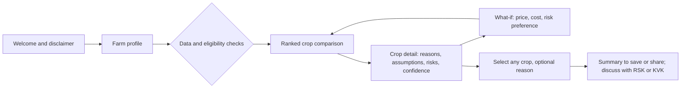
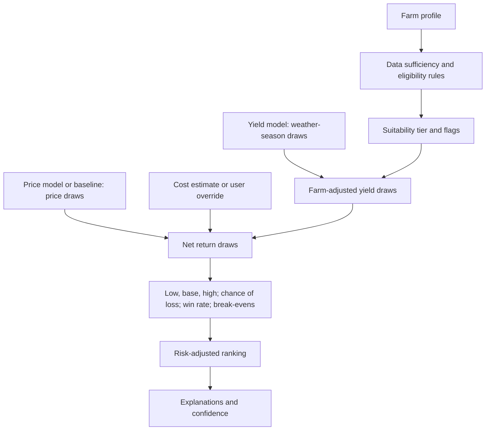

# Polaris CropPilot: Product Requirements Document (MVP)

**Version:** 1.0, draft for team review
**Date:** 19 October 2026
**Product:** Polaris CropPilot, an AI-powered Kharif crop recommendation tool
**Build constraint:** Claude Pro only, with zero additional spend

---

## Summary

CropPilot ranks four Kharif crops (tur, green gram, soybean and cotton) for a single farm in Kalyana-Karnataka. The ranking is based on predicted net return and downside risk.

- **Core ML model.** A district-level yield model is trained on historical yields and weather. It is then run across about 35 historical weather seasons to produce a range of plausible yields.
- **Other inputs.** The yield range is combined with harvest-price forecasts, dated cultivation costs and expert-reviewed suitability rules.
- **Honesty rules.** Every number is labelled as data, prediction or assumption. Models are judged against simple baselines in backtests before any accuracy is claimed.
- **Human control.** The farmer makes the final choice.

Everything is built with Claude Pro and free public data, in seven gated phases (Section 10).

---

## How to read this document

Every figure, rule and requirement carries a label. The labels show what is known, what is predicted and what is still a guess.

| Label | Meaning |
|---|---|
| `[Data]` | Observed data from a named source. It is still subject to that source's errors and gaps. |
| `[Data — farmer-reported]` | Values the user types in. The system does not verify them. |
| `[Prediction]` | Output of a model trained on historical data. Uncertain by definition. |
| `[Assumption]` | A choice, estimate, threshold or rule not yet backed by data or expert review. |
| **Confirmed** | A requirement stated in the project brief. |
| **Needs validation** | Proposed by this PRD. It must be checked with data, users or experts before anyone relies on it. |

No model in this document has been trained or evaluated yet. Every accuracy figure below is a target or a test procedure, not a result.

Source availability was spot-checked on 19 October 2026. "Verified to exist" means the source was found. It does not mean its data has been downloaded and quality-checked.

---

## 0. Scope decisions added by this PRD

The brief left the region, season and candidate crops open, so this PRD fixes them. All three are **Needs validation** and are re-checked at the Phase 0 gate (Section 10). Each has a named fallback in case the data is thinner than expected.

| Decision | Choice | Rationale | Fallback |
|---|---|---|---|
| Region | **Kalyana-Karnataka**, north-eastern Karnataka, India: Kalaburagi, Bidar, Yadgir, Raichur, Koppal, Ballari and Vijayanagara districts | Largely rainfed, semi-arid Kharif farming `[Assumption — parts of the region are under canal irrigation]`. Rainfall and harvest prices drive a recurring crop-choice problem here. District-level yield, price, cost and weather data are free and public (Section 5). One contiguous region with broadly similar conditions keeps the agronomic rules manageable `[Assumption]`. | Narrow to Kalaburagi, Bidar and Yadgir if data for the other districts is thin |
| Season | **Kharif** (southwest monsoon season). The demo planning season is **Kharif 2027**, with the decision made around late May 2027 `[Assumption]`. Models are backtested on past Kharif seasons. | Kharif is the main cropping season in the region and the most weather-exposed. All four candidate crops are Kharif crops with a Minimum Support Price (MSP). | None needed |
| Candidate crops (4) | **Tur** (red gram / pigeon pea), **green gram** (moong), **soybean**, **cotton** | The four compete for the same rainfed fields in the region. They differ sharply in duration, cost, water need and price behaviour, which makes the ranking meaningful. Karnataka's crop list in the national cost-of-cultivation survey for the 2023–26 block includes all four `[Data]`. All four trade in regional APMC markets covered by Agmarknet `[Data]`. | Swap soybean or green gram for black gram (urad) or maize. Both are also on Karnataka's cost-survey crop list `[Data]`. |

**Why this is a real problem here.** Two news reports show that both too little and too much rain matter, and that timing differs by crop:

- **Dry spell.** Recent reporting from Kalyana-Karnataka described a dry spell that put tur, green gram, black gram, maize, cotton, soybean and sunflower at risk. Officials noted that the sowing window for green gram and black gram had closed, while tur and cotton could still be sown, with tur allowed until mid-August `[Data — news report]`.
- **Heavy rain.** In another season, heavy rain damaged Kalaburagi's standing red gram crop after a record sowing area. The growers' association estimated a 50–70% production loss `[Data — association estimate]`.

---

## 1. Product overview and objectives

### 1.1 Overview

Polaris CropPilot helps a farmer, or an extension worker sitting with one, choose a Kharif crop. The user enters a short farm profile, and CropPilot then:

1. predicts a range of yields and harvest-time prices for each candidate crop from historical data
2. converts those into a range of net returns after cultivation cost
3. applies agronomic suitability rules
4. ranks the crops by risk-adjusted return.

Each crop comes with plain-language reasons, the assumptions behind the numbers, the main risks and a confidence level. The farmer makes the final choice; the tool never decides for them.

### 1.2 Where the AI is, and where it isn't

Judges and users should be able to see exactly which parts learn from data.

| Component | Technique | Category |
|---|---|---|
| Yield prediction | Supervised regression trained on historical district yields and seasonal weather | **ML: core capability** |
| Harvest-price prediction | Supervised regression on historical market prices | **ML: attempted.** Used only for crops where it beats naive baselines in backtests |
| Uncertainty ranges | Weather-season resampling through the yield model, plus empirical forecast errors from backtests | Data-driven statistics |
| Suitability and eligibility | Agronomic rules reviewed by an expert | Rules |
| Profit and ranking | Deterministic formulas | Calculation |
| Explanations | Templates filled from model outputs | Deterministic text. Optional LLM rephrasing may not add or change numbers |
| Claude (LLM) | Writes and runs the data and modelling code, drafts the UI | Development tool, **not** part of the prediction |

### 1.3 Objectives

| ID | Objective | Measured by | Status |
|---|---|---|---|
| O1 | Deliver a genuine ML prediction capability, evaluated against simple baselines. Yield is the core; harvest price is attempted. | Backtest report, Section 9 | Confirmed |
| O2 | Rank the candidate crops for a specific farm by combining predictions, suitability rules, profit, weather risk, water availability and soil | Engine test cases, Section 8 | Confirmed |
| O3 | Show low, base and high net returns, with assumptions, risks and confidence, for every crop | Crop-card completeness check | Confirmed |
| O4 | Keep farmers and experts in control of the decision | Any crop can be selected; expert review mode; no automatic actions | Confirmed |
| O5 | Build and run at zero cost beyond Claude Pro | Zero-cost checklist, Section 8 | Confirmed |
| O6 | Make uncertainty understandable to non-technical users | Comprehension test, Section 9.4 | Needs validation |

### 1.4 Non-goals for the MVP

The MVP does not cover:

- other regions or seasons
- irrigated cropping systems such as paddy or sugarcane
- intercropping, even though it is common in the region (for example tur with soybean or green gram)
- in-season advisories or pest and disease diagnosis
- input sales, credit or insurance enrolment
- satellite-based, field-level yield estimation
- any guarantee of yields, rainfall, prices or profits.

---

## 2. Problem statement and target users

### 2.1 Problem statement

In Kalyana-Karnataka most Kharif crops are grown without assured irrigation `[Assumption]`. Before the monsoon, a farmer has to choose among crops whose outcomes depend on things nobody knows yet:

- how much rain will fall, and when
- what prices will be at harvest, three to nine months later
- how costs will move.

The relevant information exists but is scattered across several places:

- Agmarknet price reports
- Commission for Agricultural Costs and Prices (CACP) cost tables
- India Meteorological Department (IMD) weather archives
- university package-of-practices booklets.

Few farmers can combine these into a farm-specific comparison of profit and downside risk. Choices therefore often lean on last season's price or on what neighbours plant `[Assumption — validate in user interviews]`. That can amplify boom-and-bust swings when many farmers switch at once `[Assumption]`.

**The question CropPilot answers:** "Given my field, and what history says about weather and prices here, which of these four crops gives me the best balance of expected profit and downside risk this Kharif, and why?"

### 2.2 Target users

| Persona | Description | Key needs | MVP use |
|---|---|---|---|
| Smallholder farmer (primary) | Small, mostly rainfed holding on black or red soil. Kannada-first. Smartphone access may be shared `[Assumption]`. | Few inputs, rupees per acre, plain explanations, honesty about risk | Uses the tool directly or with assistance |
| Extension intermediary | Raitha Samparka Kendra (RSK) officer, Krishi Vigyan Kendra (KVK) scientist, or Farmer Producer Organisation (FPO) staff | Consistent, transparent comparisons they can adjust and explain | Runs sessions with farmers and reviews outputs |
| Agronomy or agri-economics expert | University, KVK or department specialist | Inspect and correct rules, thresholds and cost assumptions | Expert review mode |
| Hackathon judges | Technical and domain evaluators | Evidence of real ML and honest evaluation | Model card, backtest results, data gap register |

### 2.3 Jobs to be done

A farmer wants to:

- compare crops in rupees per acre
- see how bad a poor season could get
- understand why one crop ranks above another
- try "what if the price is lower" or "what if my costs are higher"
- leave with a summary to discuss with family or an RSK officer.

An extension worker wants the same comparison quickly and consistently, with the assumptions visible so they can correct them.

---

## 3. Functional requirements and core user journey

### 3.1 Core user journey



| Step | What the user does | What the system does | Target |
|---|---|---|---|
| 1. Welcome | Reads a short note that this is decision support, not a guarantee | Shows the season, region and data "as of" dates | Under 30 seconds |
| 2. Farm profile | Enters district, field size, soil, drainage, water, previous crop and risk preference | Validates inputs. Unknowns are allowed and widen the uncertainty | Under 3 minutes |
| 3. Checks | Nothing | Runs data sufficiency per crop, eligibility rules and suitability tier | Instant |
| 4. Comparison | Scans ranked crop cards | Shows low / base / high net return per acre and for the whole field, chance of loss, suitability and confidence | Under 2 seconds to render |
| 5. Detail | Opens a crop | Shows reasons, drivers, assumptions, risks, analog seasons and data sources | — |
| 6. What-if | Adjusts price, cost or risk preference | Re-ranks live and shows when the ranking flips | — |
| 7. Select | Picks any crop, including one not ranked first | Records the choice and an optional reason, and states the decision is theirs | — |
| 8. Summary | Saves, prints or shares | Produces a summary with all labels and disclaimers | — |

### 3.2 Functional requirements

Priority: **P0** must work in the demo, **P1** should, **P2** is a stretch goal.

| ID | Requirement | Priority | Status |
|---|---|---|---|
| FR-01 | Capture the farm profile: district, field size (acres + guntas), soil type and depth, drainage, water availability, previous Kharif crop, and season (fixed to Kharif 2027 and displayed) | P0 | Confirmed (fields from brief); drainage and unit choices Needs validation |
| FR-02 | Accept optional inputs: Soil Health Card values (pH, EC, organic carbon, N, P, K), the farmer's own typical yield per crop, own cost per acre, and planned late sowing | P1 | Needs validation |
| FR-03 | Allow "don't know" for soil and drainage. Widen the uncertainty and lower the confidence instead of blocking | P0 | Needs validation |
| FR-04 | Check data sufficiency per district and crop. Show "not enough local data" instead of a number when the rule in 5.5 fails | P0 | Needs validation |
| FR-05 | Apply eligibility and suitability rules, and show the tier and the reason | P0 | Confirmed (rules in brief); rule content Needs validation |
| FR-06 | Produce a yield distribution per crop from the ML model run across historical weather seasons | P0 | Confirmed (ML yield); method Needs validation |
| FR-07 | Produce a harvest-price distribution per crop. Use the ML price model where it beats baselines, otherwise the better baseline | P0 baseline, P1 ML | Confirmed ("yield and/or price") |
| FR-08 | Show a cultivation cost per crop with its source and year, and let the user override it | P0 | Confirmed (costs); override Needs validation |
| FR-09 | Compute low / base / high net return per acre and for the whole field, the chance of a loss, and the break-even price and yield | P0 | Confirmed (scenarios); extra metrics Needs validation |
| FR-10 | Rank eligible crops by risk-adjusted return, with a risk-preference selector (cautious / balanced / growth) | P0 | Confirmed (ranking); method Needs validation |
| FR-11 | Flag "close calls" when the top crops win in similar shares of simulated seasons | P1 | Needs validation |
| FR-12 | Comparison view: ranked cards plus a side-by-side table | P0 | Confirmed |
| FR-13 | Crop detail view: reasons, key drivers, assumptions, risks, analog seasons, confidence, and sources with as-of dates | P0 | Confirmed |
| FR-14 | Label every displayed number `[Data]`, `[Prediction]` or `[Assumption]` | P0 | Confirmed |
| FR-15 | What-if controls for price and cost, with live re-ranking | P1 | Needs validation |
| FR-16 | Let the user select any crop and record an optional reason. Generate a summary that states the decision is theirs and suggests discussing it with an RSK or KVK | P0 | Confirmed (select crop, human control) |
| FR-17 | Expert review mode: view rules, multipliers, weights and backtest metrics; adjust rule parameters for a session; add a review note | P1 | Needs validation (supports the confirmed human-control requirement) |
| FR-18 | "About the model and data" page: model card, backtest results against baselines, data gap register, limitations | P0 | Needs validation (supports the confirmed evaluation requirement) |
| FR-19 | No-guarantee language throughout, enforced by a banned-word check | P0 | Confirmed |
| FR-20 | Kannada interface labels | P2 | Needs validation |
| FR-21 | Save and reload a farm profile on the user's device | P2 | Needs validation |
| FR-22 | Optional AI-powered plain-language or Kannada rephrasing of explanations, grounded only in computed values, with templates as the fallback | P2 | Needs validation |

### 3.3 Farm profile fields

| Field | Options or type | Required | Used for |
|---|---|---|---|
| District | Kalaburagi, Bidar, Yadgir, Raichur, Koppal, Ballari, Vijayanagara | Yes | Model unit, prices, weather |
| Field size | Acres + guntas (1 acre = 40 guntas) | Yes | Whole-field totals |
| Soil type | Deep black, medium black, shallow black, red, or mixed / don't know | Yes | Suitability tier |
| Drainage | Drains well, waterlogs after heavy rain, don't know | Yes | Suitability tier |
| Water availability | Rainfed only; protective irrigation (one or two life-saving irrigations); assured irrigation | Yes | Eligibility and downside adjustment |
| Previous Kharif crop | The four crops, other, none | Yes | Rotation flags |
| Risk preference | Cautious, balanced (default), growth | Yes | Ranking weight |
| Planned sowing | Normal window, late (after mid-July) | Optional (P1) | Eligibility of short-duration crops |
| Soil Health Card values | pH, EC, OC, N, P, K | Optional | Suitability flags |
| Own typical yield per crop | Quintals per acre | Optional | Farm calibration |
| Own cost per crop | Rupees per acre | Optional | Replaces the default cost |

All profile values are `[Data — farmer-reported]`. The MVP collects no name, phone number, ID number or GPS location.

### 3.4 Screens

| Screen | Purpose |
|---|---|
| S1 | Welcome and disclaimer |
| S2 | Farm profile |
| S3 | Ranked comparison |
| S4 | Crop detail |
| S5 | What-if |
| S6 | Selection summary |
| S7 | About the model and data |
| S8 | Expert review mode (P1) |

The interface is mobile-first because most target users will be on phones `[Assumption]`.

---

## 4. AI/ML requirements and proposed prediction approach

### 4.1 Decision-time framing

The recommendation is made before sowing. The backtests and the demo both use a decision date of **31 May** of the planning year `[Assumption]`.

| On the decision date, the system knows | On the decision date, the system does not know |
|---|---|
| Historical yields up to the latest published season | The season's rainfall |
| Prices up to May | The harvest-time price |
| Costs from the latest state estimate | Pest pressure |
| In some years, the coming season's MSP. Announcement dates vary; the Kharif 2026-27 MSPs were approved on 13 May 2026 `[Data]`. | |

This shapes the design in two ways:

- **Yield.** The yield model learns how yield responds to weather, using the actual weather of past seasons. At decision time the season's weather is unknown, so the model is run under every historical weather season to produce a distribution of plausible yields.
- **Price.** The price model forecasts the harvest-window price using only information available on the decision date.

### 4.2 Yield model

| Aspect | Specification |
|---|---|
| Unit of analysis | Harmonised district × Kharif season × crop (five model units; see 5.3) |
| Target | Yield in kg per hectare as published `[Data]`. Cotton is published in kg of lint per hectare and converted later. |
| Training years | From 1997-98, or the earliest year available, to the latest published season `[Needs validation]` |
| Features | District indicator; season year (technology trend); June, July, August, September and October rainfall; June–September total; rainy days (2.5 mm or more, the IMD convention); longest dry spell in July–August; heavy-rain days (64.5 mm or more) in September–October; mean maximum temperature in August–September; optional irrigated share of crop area (ICRISAT DLD, to 2017) |
| Baselines | **B1:** mean of the district's previous five seasons (primary). **B2:** district linear trend. |
| Candidate models | **M1:** ridge regression per crop with standardised features (interpretable; the default). **M2:** gradient-boosted trees pooled across crops, with crop as a feature (scikit-learn `HistGradientBoostingRegressor`). Optional **M3:** random forest. |
| Tuning | Regularisation and tree settings are chosen by inner time-series cross-validation on training years only |
| Selection rule | Written down before test results are seen. Per crop, use the model with the lowest backtest MAE, but only if it beats B1. Otherwise use B1 plus its empirical error distribution, and say so in the app. |

Crops are sensitive at different times: flowering-time dry spells matter for tur, while harvest-time rain matters for green gram and soybean. These critical windows start as simple monthly features and are refined only if backtests support it `[Assumption]`.

### 4.3 Harvest-price model

| Aspect | Specification |
|---|---|
| Unit | District (CEDA monthly aggregates, Census 2011 districts) × crop × marketing year |
| Target | Average monthly modal price (₹ per quintal) over the crop's harvest-marketing window `[Data target]`. Starting windows: green gram September–October, soybean October–November, cotton (kapas) November–January, tur December–February `[Assumption — confirm from arrival peaks in Phase 1]`. |
| Modelled quantity | Log of the harvest-window price divided by the May price |
| Features (known by 31 May) | May modal price; average price over the past 12 months; last year's harvest-window price; the MSP announced before the decision date (otherwise last season's); last harvest window's arrivals relative to their five-year average |
| Baselines | **P1:** persistence (harvest price equals the May price). **P2:** seasonal naive (equals last year's harvest-window price). |
| Candidate models | Ridge regression pooled across crops and districts; a gradient-boosted alternative |
| Ship rule | Use ML for a crop only if two conditions hold in backtests `[Assumption thresholds]`. First, its MAPE improves on the better baseline by at least 5% relative. Second, its direction-of-change accuracy exceeds 50%. Otherwise use the better baseline with its empirical errors. |

Prices in neighbouring districts move together. The effective sample size is therefore closer to (years × crops) than to (years × crops × districts). The backtest report must say this and show the uncertainty around the metrics.

### 4.4 From predictions to ranges

The model outputs become ranges in four steps:

1. **Weather seasons.** For target season T, take each historical weather season w from 1991 to the latest complete season, about 35 seasons `[Assumption]`. The yield model produces a prediction using T's trend and w's weather.
2. **Model error.** Multiply each yield prediction by a model-error factor drawn from that crop's backtest residuals. The range then reflects both weather and model error.
3. **Price draws.** Each price draw is the price forecast multiplied by a drawn backtest error. Where a weather season also has price data, use the price error from the same season (paired-season sampling). This keeps the real-world link between local shortfalls and higher prices `[Assumption — method]`.
4. **Volume.** Generate about 2,000 draws per crop `[Assumption]`.

Section 6 turns these draws into net-return scenarios.

### 4.5 Leakage controls

| Information | Known on 31 May? | Training use | Decision-time use |
|---|---|---|---|
| Season rainfall and temperature | No | Actual values | Simulated from historical seasons |
| Season year (trend) | Yes | Yes | Yes |
| May price, past-year prices | Yes | Price model | Price model |
| Season MSP | Varies by year | Only if announced before 31 May that year | Same rule |
| Current-season sown area | No | Not used | Not used |
| Latest season's yield | Often not yet published | Only if published by the decision date | Same rule |

Backtests rebuild the information set as of each past decision date. Test seasons are never used for tuning, feature selection or model choice.

### 4.6 Model deliverables

Each model ships with a model card covering:

- purpose and limits
- training data and years
- features
- baselines
- backtest protocol
- metrics per crop, with sample sizes
- interval coverage
- known failure cases, for example seasons with extreme excess rain
- the selection decision and the date.

The app's "About the model and data" page shows a plain-language version.

### 4.7 What the team will not do

- **No early accuracy claims.** Nothing is claimed before backtests exist.
- **No LLM numbers.** The LLM never generates a number shown to users.
- **No crop-label datasets.** Crop-label classification datasets contain no yields, prices or costs, so they cannot support profit ranking.
- **No tuning on test seasons.**
- **No cherry-picking.** Results are reported for every crop, not only where the model looked good.

---

## 5. Data requirements, potential sources, and data gaps

### 5.1 What the MVP needs

- District-level Kharif yields for the four crops, over as many seasons as possible
- Daily or monthly weather for the same districts and seasons
- Monthly harvest-window prices and arrivals
- A dated cultivation-cost estimate per crop for Karnataka
- MSP history
- Agronomic suitability guidance
- Farmer-provided soil and water information

### 5.2 Candidate sources

"Verified to exist" means the source was found on 19 October 2026. Coverage for the specific districts, crops and years still has to be checked in Phases 0–1.

| Need | Source | What it provides | Access and MVP role | Known limitations | Status |
|---|---|---|---|---|---|
| Yields (primary) | Directorate of Economics and Statistics (DES), Ministry of Agriculture: district-wise crop production statistics (data.desagri.gov.in) | District × season × crop area, production and yield, compiled from state statistics authorities `[Data]` | The portal appears to require a login `[Needs validation]`. Primary training target | Publication lag; district boundary changes; cotton reported in bales | Verified to exist; years and format Needs validation |
| Yields (mirror) | India Data Portal (ISB) APY dataset | Repackaged DES area-production-yield data, last updated 2022 | Free download `[Needs validation]`. Backup | May lag the official source | Verified to exist |
| Yields (long history) | ICRISAT–TCI District Level Database (DLD) | 571 districts in 20 states, 1966–2017, adjusted for district boundary changes. Includes crop-wise irrigated area | Open access at data.icrisat.org/dld. Cross-check, earlier years, irrigation share | Ends in 2017 for most series. An update to 2019-20 was announced; status unknown | Verified to exist |
| Prices (primary) | CEDA Agri Market Data, Ashoka University (built on Agmarknet) | Monthly modal prices and arrivals aggregated to Census 2011 districts, from 2001. Raw files downloadable | Free download; licence terms to confirm. Primary price history | Inherits Agmarknet data-quality issues | Verified to exist |
| Prices (raw) | Agmarknet (agmarknet.gov.in) | Daily minimum, maximum and modal prices and arrivals, by market and variety | Web reports. Spot checks and the latest months | Report pages and formats can change `[Assumption]` | Verified to exist |
| Prices (current) | data.gov.in "Current daily price of various commodities from various markets (Mandi)" | Today's prices from Agmarknet | Free API key. Optional decision-date price | Current day only. Developers report frequent downtime `[unverified third-party report]` | Verified to exist |
| MSP | Cabinet decisions via PIB; CACP Kharif price policy reports | Annual MSP per crop. Kharif 2026-27 MSPs approved 13 May 2026 | Free. Reference line in the UI and a price-model feature | MSP is not a guaranteed realised price | Verified to exist |
| Cultivation costs | CACP Kharif price policy reports and the DES Cost of Cultivation Scheme | State-wise costs per hectare (A2, A2+FL, C2). Karnataka's 2023–26 crop list includes tur, moong, soybean and cotton | Free reports and tables. Base cost per crop | State averages, not district. Published a few seasons after the fact `[Assumption — check the report]`. Values must be extracted from PDF tables | Crop list verified; per-year tables Needs validation |
| Weather (MVP) | NASA POWER | Daily precipitation and temperature on a roughly 0.5° grid from 1981. Free API, no authentication | Request a CSV per district coordinate in the browser, then upload. Primary MVP weather | Coarse; reanalysis-based, not station data | Verified to exist |
| Weather (quality upgrade) | IMD gridded data, IMD Pune | Daily rainfall at 0.25° from 1901; maximum and minimum temperature at 1.0° from 1951 | Free binary files. Cross-check and upgrade | Large files that must be subset locally before upload | Verified to exist |
| Seasonal outlook | IMD long-range monsoon forecasts | Probabilistic seasonal outlook | Public bulletins. P2: re-weight weather seasons | District-level skill likely limited `[Assumption]` | Needs validation |
| Soil (farm) | The farmer's Soil Health Card | pH, EC, organic carbon, N, P and K for their land | Typed in by the user. Optional suitability flags | Many farmers may not have a recent card `[Assumption]` | — |
| Soil (default hints) | ISRIC SoilGrids 2.0 | Modelled soil properties at 250 m, six depths, with uncertainty. REST point query | Free API via the browser. P2: default hints per district | Model-based and too coarse for a field decision | Verified to exist |
| Agronomy | University of Agricultural Sciences (UAS) Raichur package of practices; local KVKs | Crop calendars, soil and water suitability, sowing windows | Obtain documents or an expert. Rules and assumptions | Must be obtained and transcribed; jurisdiction to confirm | Needs validation |
| Agronomy (generic) | FAO ECOCROP | Crop environmental ranges | Free. Cross-check rule ranges | Generic, not local | Needs validation |
| Inflation index | CPI for Agricultural Labourers (Labour Bureau) | Monthly index | Free. Cost inflation factor | Only a proxy for input-cost change `[Assumption]` | Needs validation |
| Locations | District headquarters coordinates | Latitude and longitude | Public. NASA POWER queries | One point does not represent a whole district `[Assumption]` | — |

### 5.3 Processing rules

**District harmonisation.** Boundaries changed during the training period, so the model uses five harmonised units. A farmer selects their current district and the app maps it to its unit. Exact split years are `[Needs validation]` against the data.

| Model unit | Current districts | Why merged |
|---|---|---|
| Kalaburagi + Yadgir | Kalaburagi, Yadgir | Yadgir was carved from Kalaburagi |
| Ballari + Vijayanagara | Ballari, Vijayanagara | Vijayanagara was carved from Ballari in 2021 |
| Raichur | Raichur | — |
| Koppal | Koppal | Carved from Raichur in 1997; merged back into Raichur for years where Koppal is missing |
| Bidar | Bidar | — |

**Units.**

- Production in tonnes is converted to quintals (1 quintal = 100 kg).
- Yields are shown per acre (1 hectare = 2.471 acres).
- Cotton production is reported in bales of 170 kg of lint, but market prices are for kapas (seed cotton). So kapas yield = lint yield ÷ ginning outturn, with a starting ginning outturn of 0.34 `[Assumption — confirm with CACP tables or an expert]`.

**Price cleaning.**

- Drop records where the modal price is zero or falls outside that day's minimum–maximum range.
- Restrict to raw commodities (whole tur, not dal).
- Cap extreme monthly values at the 1st and 99th percentiles per crop and district.
- Require a minimum number of trading days per month `[Assumption]`.

**Naming.** One mapping table links crop names across DES, CEDA/Agmarknet, CACP and MSP releases.

**Weather features.** Daily data are aggregated into the seasonal features in 4.2. The MVP uses the district headquarters point. At P1, the pipeline averages three to five points per district and compares NASA POWER against IMD or ICRISAT rainfall for overlapping years.

**Provenance.** Every raw file is logged with its source URL, download date and coverage. Every derived file records which raw files and script produced it.

### 5.4 Data gap and dependency register

| ID | Gap or dependency | Impact | Handling |
|---|---|---|---|
| G1 | No farm-level yield data; models predict district averages | High | Label clearly; optional farmer calibration (6.3); wide ranges; expert review |
| G2 | Soybean, and possibly green gram, may have short or patchy history in some districts | High | Data sufficiency rule (5.5); pool units for training; fallback crops |
| G3 | The latest one or two seasons of district yields may be unpublished | Medium | Train on what exists; show "data through [season]" |
| G4 | Costs are state averages with a lag; no district costs | High | Inflation adjustment `[Assumption]`; user override; show the cost year |
| G5 | Harvest-marketing windows are not documented in one place | Medium | Derive from arrival peaks; expert check |
| G6 | Farmers may sell to private traders at prices different from APMC modal prices | Medium | State the assumption; let the user override the price |
| G7 | No separate irrigated yields at district level | Medium | The protective-irrigation adjustment is an `[Assumption]`; assured-irrigation farms are out of scope |
| G8 | No parcel-level soil maps in the MVP | Medium | Farmer inputs and Soil Health Card; SoilGrids only as hints |
| G9 | Pest and disease incidence not integrated | Medium | Qualitative risk notes curated by an expert |
| G10 | NASA POWER is coarse; IMD files are too large to upload directly | Medium | NASA POWER for the MVP; an IMD subset as cross-check or upgrade |
| G11 | The share of the crop actually procured at MSP is not modelled | Medium | MSP shown as a reference, never as a floor |
| G12 | Crop and market naming varies across sources | Low | Mapping table with tests |
| G13 | Claude's sandbox cannot reach government data portals | High | Download in the browser and upload files under 30 MB (Section 7.2) |
| G14 | Access to an agronomy expert during the hackathon | High | Book in Phase 0; otherwise label all rules as unreviewed |

### 5.5 Data sufficiency rule

A crop gets numbers for a district only if its harmonised unit has at least 10 Kharif seasons with at least 500 hectares of that crop `[Assumption — sensitivity-test in Phase 1]`.

Otherwise the app says there is not enough local data and suggests asking an RSK or KVK. Expert mode can show a neighbouring unit's estimate, clearly labelled.

---

## 6. Recommendation logic and profitability calculations

### 6.1 Pipeline



### 6.2 Step 1: eligibility, suitability, and flags

**Exclusions.** Excluded crops are shown at the bottom with the reason, never silently hidden. A crop is excluded when:

- the data sufficiency rule fails, or
- the user plans to sow after the crop's typical window, for example green gram or soybean after mid-July `[Assumption]`. Local officials have described a later sowing cut-off for tur than for short-duration pulses; confirm the windows with an expert.

**Assured irrigation.** The MVP's models describe rainfed outcomes. For farms with assured irrigation, the app shows a notice and labels all results as low confidence `[Assumption]`.

**Suitability tiers.** Each crop gets a tier from soil type and drainage. The tier sets a yield multiplier `[Assumption]`:

| Tier | Yield multiplier |
|---|---|
| Good | 1.00 |
| Fair | 0.90 |
| Marginal | 0.75 |
| Not suitable | Crop excluded |

The starting matrix below is a placeholder based on general agronomic guidance. It **must** be replaced or confirmed by an expert in Phase 6.

| Soil and drainage | Tur | Green gram | Soybean | Cotton |
|---|---|---|---|---|
| Deep black, drains well | Good | Fair | Good | Good |
| Medium black, drains well | Good | Good | Good | Good |
| Shallow black | Fair | Fair | Fair | Marginal |
| Red | Fair | Good | Fair | Fair |
| Waterlogs after heavy rain | Marginal | Marginal | Marginal | Fair |
| Mixed or don't know | Fair | Fair | Fair | Fair |

All cells are `[Assumption — draft, unreviewed]`.

**Flags.** These are shown to the user but have no rupee effect:

- **Same crop as last Kharif:** pest and disease carry-over.
- **Cotton after cotton:** a stronger warning.
- **Soil Health Card values outside expert-set ranges.** The expert sets these thresholds; they are not invented here.
- **Field occupancy:** tur and cotton hold the field into the winter, while green gram and soybean may leave room for a Rabi crop on residual moisture `[Assumption]`.

### 6.3 Step 2: farm-adjusted yield draws

For draw i of crop c:

`Y_i = ŷ(T, w_i) × (1 + e_i) × m`

where:

- ŷ is the yield model's prediction for target season T under weather season w_i
- e_i is a drawn relative model error
- m is the suitability multiplier.

**Farm calibration.** If the farmer gives their own typical yield, m is replaced by a calibration ratio:

`r = farmer's typical yield ÷ district five-season mean`, clipped to 0.6–1.4 `[Assumption]`

The card then says "personalised with your reported yield `[Data — farmer-reported]`".

**Protective irrigation.** For draws whose July–September rainfall is in the driest third of seasons, Y_i moves halfway toward the median draw (α = 0.5) `[Assumption — expert to set]`.

**Conversion.** Yields are converted from kg per hectare to quintals per acre (÷ 100, then ÷ 2.471). Cotton is converted from lint to kapas as in 5.3.

### 6.4 Step 3: price draws

`P_i = P̂ × exp(r_i)`

where P̂ is the price forecast (ML or baseline) and r_i is a drawn backtest log-error. Where possible, r_i is paired with the weather season (see 4.4).

The season's MSP is drawn as a reference line on every chart but is not used as a price floor `[Assumption]`. The user can override the expected price in the what-if panel.

### 6.5 Step 4: cost draws

**Base cost per acre** `[Data × Assumption]`:

`C = A2+FL cost per hectare (Karnataka, latest year Y) × CPI-AL(T) ÷ CPI-AL(Y) ÷ 2.471`

The cost comes from CACP or DES for that crop. A2+FL is paid-out costs plus the imputed value of family labour; it is the cost concept used for MSP.

**Cost draws:** `C_i = C × (1 + u_i)`, with u_i uniform between −10% and +15%, skewed toward overruns `[Assumption]`.

**User override.** An override replaces C and keeps a ±10% band.

**C2 basis.** As a P2 feature, expert mode can switch to C2, which adds land rent and interest on owned capital.

### 6.6 Step 5: net return scenarios

| Quantity | Formula | Label |
|---|---|---|
| Net return per acre, draw i | `NR_i = Y_i × P_i − C_i` | `[Prediction]` |
| Whole-field net return | `NR_i × (acres + guntas ÷ 40)` | `[Prediction]` |
| Low / base / high | 10th, 50th and 90th percentiles of NR_i | `[Prediction]` |
| Chance of a loss | Share of draws with NR_i below zero | `[Prediction]` |
| Win rate | Share of draws in which this crop has the highest NR among eligible crops (draws aligned by weather season) | `[Prediction]` |
| Break-even price | `C ÷ median yield` | `[Prediction]` |
| Break-even yield | `C ÷ median price` | `[Prediction]` |

The UI must state what these mean:

- **Low** is a result that history suggests roughly one season in ten could fall below.
- **Outside the range:** by construction, outcomes fall outside the low-to-high range about one season in five.
- **Base** is the middle outcome, not a promise.

### 6.7 Step 6: ranking

**Score.** Using per-acre values `[Assumption — check λ in user testing]`:

`Score = (1 − λ) × base + λ × low`

| Risk preference | λ |
|---|---|
| Cautious | 0.7 |
| Balanced (default) | 0.4 |
| Growth | 0.1 |

**Tie-break.** Eligible crops are sorted by score. If two scores are within 5% of the top score's magnitude, the crop with the lower chance of loss ranks higher, then the one with higher confidence `[Assumption]`.

**Close calls.** When the top two crops' win rates differ by less than 10 percentage points, both cards show a "close call: both are reasonable" badge `[Assumption]`.

All eligible crops are always shown.

### 6.8 Step 7: explanations and confidence

**What every crop card shows:**

- **Why it ranks where it does:** up to three template reasons generated from comparisons, such as lowest cost, best low-scenario result or highest win rate.
- **Main drivers:** the yield model's key drivers, from ridge contributions or permutation importance. For example: "dry spells in July–August lower this crop's predicted yield most".
- **Analog seasons:** the historical seasons behind the low and high draws, named by year.
- **Assumptions used.**
- **Risks:**
  - weather sensitivity: the change in median predicted yield in the driest third of seasons
  - price volatility: the coefficient of variation of harvest-window prices over the last ten seasons `[Data]`
  - field occupancy and rotation flags
  - expert pest notes.
- **A confidence badge** (rules below).
- **What this tool cannot see:** exact soil, local weather, market access, input availability and the farmer's own management.

**Confidence rules** `[Assumption]`:

| Confidence | Conditions |
|---|---|
| High | Model beat B1 with yield skill of 0.10 or more; backtest low-to-high coverage between 70% and 90%; at least 15 seasons of data for the unit and crop |
| Medium | Skill above zero, or baseline used with coverage between 60% and 95%; at least 10 seasons |
| Low | Anything else, or soil and drainage both unknown, or assured irrigation |

**Language rules.** Say "estimated", "could" or "in 7 of the last 30 seasons". Never say "will", "guaranteed", "sure" or "assured". A banned-word scan runs on all interface text (FR-19).

### 6.9 Worked example with dummy values

These numbers are **made up to test the formulas**. They are not data and not predictions.

| | Crop A | Crop B |
|---|---|---|
| Low / base / high net return per acre | −₹4,000 / ₹10,000 / ₹24,000 | ₹2,000 / ₹8,000 / ₹13,000 |
| Score, cautious (λ 0.7) | 0.3 × 10,000 + 0.7 × (−4,000) = ₹200 | 0.3 × 8,000 + 0.7 × 2,000 = ₹3,800 |
| Score, balanced (λ 0.4) | 0.6 × 10,000 + 0.4 × (−4,000) = ₹4,400 | 0.6 × 8,000 + 0.4 × 2,000 = ₹5,600 |
| Score, growth (λ 0.1) | 0.9 × 10,000 + 0.1 × (−4,000) = ₹8,600 | 0.9 × 8,000 + 0.1 × 2,000 = ₹7,400 |
| Rank (cautious, balanced, growth) | 2nd, 2nd, 1st | 1st, 1st, 2nd |

Break-even and whole-field checks for Crop A, using dummy inputs (base cost ₹20,000 per acre, median yield 5.0 quintals per acre, median price ₹6,000 per quintal):

| Check | Calculation | Result |
|---|---|---|
| Break-even price | 20,000 ÷ 5.0 | ₹4,000 per quintal |
| Break-even yield | 20,000 ÷ 6,000 | 3.33 quintals per acre |
| Whole-field base, 2 acres 20 guntas (= 2.5 acres) | 10,000 × 2.5 | ₹25,000 |

These cases become unit tests in Phase 3.

### 6.10 Engine data contract

The Python pipeline exports one JSON file, which the dashboard embeds. Fixing this shape in Phase 0 lets UI work start with mock data. All zeros, nulls and arrays are placeholders.

```json
{
  "meta": {"version": "0.1", "built": "YYYY-MM-DD", "target_season": "Kharif 2027",
           "sources": [{"id": "DES_APY", "downloaded": "YYYY-MM-DD", "coverage": "..."}]},
  "units": {"kalaburagi_yadgir": ["Kalaburagi", "Yadgir"], "bidar": ["Bidar"]},
  "crops": {"tur": {"name": "Tur (red gram)", "harvest_window": ["Dec", "Jan", "Feb"],
                    "window_label": "Assumption"}},
  "yield_draws": {"bidar|tur": {"weather_seasons": [1991, 1992],
                                "q_per_acre": [0.0, 0.0], "model": "ridge", "label": "Prediction"}},
  "price": {"bidar|tur": {"forecast": 0, "log_errors": [], "error_seasons": [],
                          "model": "persistence", "label": "Prediction"}},
  "costs": {"tur": {"a2fl_per_acre": 0, "source": "CACP", "cost_year": "YYYY-YY",
                    "inflation_factor": 0, "band": [-0.10, 0.15], "label": "Assumption"}},
  "msp": {"tur": {"value": 0, "season": "2026-27", "source": "PIB", "label": "Data"}},
  "rules": {"suitability": {}, "multipliers": {"Good": 1.0, "Fair": 0.9, "Marginal": 0.75}},
  "backtest": {"tur": {"yield_skill": null, "coverage": null, "n": null, "confidence": null}}
}
```

---

## 7. Non-functional requirements and key risks

### 7.1 Non-functional requirements

| ID | Requirement | Target | Status |
|---|---|---|---|
| NFR-01 | Cost | ₹0 beyond Claude Pro: no paid APIs, hosting or usage credits | Confirmed |
| NFR-02 | Platform | Built with Claude Pro features only: code execution and file creation, Projects and artifacts. Claude Code is optional (7.2) | Confirmed |
| NFR-03 | Performance | Ranking for four crops × 2,000 draws renders in under 2 seconds on a mid-range phone | Needs validation |
| NFR-04 | Size | Embedded data under 1 MB; the whole artifact is one file | Needs validation |
| NFR-05 | Mobile-first | Usable at 360 px width, with large touch targets, in portrait | Needs validation |
| NFR-06 | Transparency | 100% of displayed numbers carry a label, a source or method, and an as-of date | Confirmed |
| NFR-07 | Honesty | No guarantee language; every point estimate shown with its range; model quality shown only from backtests | Confirmed |
| NFR-08 | Privacy | No names, phone numbers, ID numbers or GPS. District only. Inputs stay in the browser | Needs validation |
| NFR-09 | Reproducibility | Scripts, data snapshots and fixed random seeds stored in the Claude Project; a rerun reproduces the metrics | Needs validation |
| NFR-10 | Maintainability | Rules, costs, MSP and thresholds live in config, not code; a yearly refresh checklist exists | Needs validation |
| NFR-11 | Accessibility and locale | Plain language; Indian number format (₹1,25,000); acres, guntas and quintals; Kannada in P2 | Needs validation |
| NFR-12 | Availability | The published dashboard's core flow works from a link without signing in | Needs validation |
| NFR-13 | Licensing | Comply with each source's terms (Open Government Data licence, CEDA, ISRIC) and attribute sources | Needs validation |

### 7.2 Claude Pro platform constraints

These constraints shape the build plan. Each was checked against Anthropic's help centre on 19 October 2026. Re-check them before the hackathon, because plans change.

| Fact | Consequence for CropPilot |
|---|---|
| Code execution and file creation is available on Pro. It can run Python and build ML models from uploaded data | All cleaning, training and backtesting happens in Claude's sandbox |
| Uploads and downloads are limited to 30 MB per file | Filter data to the region before downloading; keep IMD data out unless it has been subset |
| Pro's sandbox reaches an approved list of package managers and GitHub. Adding custom domains is described only for Team and Enterprise owners | Government portals can't be fetched from the sandbox: download in the browser and upload. Check Settings > Capabilities in Phase 0 |
| Artifacts require code execution and file creation to be enabled | Turn it on in Settings > Capabilities |
| Pro users can publish artifacts and share a link. In AI-powered artifacts, usage counts against each viewer's own Claude limits | The core dashboard must not depend on AI calls. Optional AI rephrasing costs the team nothing |
| Persistent storage for artifacts is available on Pro | Allows an optional local save of farm profiles (FR-21) |
| Files in a Project are reachable from the computing environment | Keep cleaned datasets and scripts in one Project |
| Claude Code is included in Pro. Usage limits (five-hour session and weekly) are shared across Claude and Claude Code, and usage credits beyond the plan are billed | Never enable usage credits; plan heavy work across sessions. Use Claude Code only if the team accepts free local tools |
| Public sharing of conversations that contain code-execution file outputs is disabled for Pro | Share results through the published artifact and downloaded files, not chat links |

### 7.3 Risk register

| ID | Risk | Likelihood | Impact | Mitigation | Phase |
|---|---|---|---|---|---|
| R1 | A key portal is down, needs a login, or blocks bulk download | Medium | High | Use mirrors (CEDA, ICRISAT DLD, India Data Portal); start data work first; keep snapshots | 0–1 |
| R2 | Too few seasons for soybean or green gram in some districts | High | Medium | Sufficiency rule, pooled training, fallback crops | 1 |
| R3 | District boundary changes corrupt the panel | High | Medium | Harmonised units; mapping tests | 1 |
| R4 | Unit errors (lint vs kapas, tonnes vs quintals) | Medium | High | Conversion table; unit tests; sanity ranges | 1, 3 |
| R5 | ML does not beat the baseline | Medium | Medium | Report honestly; run the Phase 2 contingency; use ML only where it helps | 2 |
| R6 | Overfitting on small samples | High | Medium | Regularised models, few features, rolling-origin tests, no tuning on test seasons | 2 |
| R7 | Leakage of information unavailable on the decision date | Medium | High | As-of feature table (4.5); code review checklist | 2 |
| R8 | District averages misread as farm predictions | High | High | Labels, farmer calibration, wide ranges, expert review, explicit wording | 3–5 |
| R9 | Price data errors and outliers | High | Medium | Cleaning rules; monthly aggregation; cross-check with Agmarknet | 1 |
| R10 | Stale or unrepresentative cost data | High | Medium | Inflation adjustment, user override, cost year shown | 1, 3 |
| R11 | Weather at one point is unrepresentative of the district | Medium | Medium | Multi-point averages; IMD cross-check | 1–2 |
| R12 | Climate shift makes older weather seasons less relevant | Medium | Medium | Sensitivity test using 2001 onward only | 2 |
| R13 | Herding: if many farmers follow one recommendation, prices fall | Low (MVP), high at scale | High | Show win rates and close calls; note market-wide risk; never push a single answer | 4–5 |
| R14 | Results read as guarantees | Medium | High | Ranges, wording rules, banned-word scan, disclaimers | 4–5 |
| R15 | Claude Pro usage limits slow the team | High | Medium | Phase-sized chats, small datasets, outputs saved to the Project, work spread across sessions | All |
| R16 | Agronomic rules are wrong | Medium | High | Expert review; rules labelled unreviewed until then | 6 |
| R17 | Kannada translations are wrong | Medium | Medium | Native-speaker review; English fallback | 5 |
| R18 | A data licence conflicts with a public demo | Low | Medium | Check terms in Phase 0; attribute sources; non-commercial use | 0 |
| R19 | Scope creep | Medium | Medium | Phase gates; P2 items only after P0 is done | All |

---

## 8. MVP scope and acceptance criteria

### 8.1 Scope

| In scope | Out of scope |
|---|---|
| Seven districts of Kalyana-Karnataka, mapped to five model units | Other regions |
| Kharif, with Kharif 2027 as the demo season | Rabi, summer and multi-season sequences (P2 note only) |
| Tur, green gram, soybean and cotton as sole crops | Intercrops, horticulture, paddy, sugarcane |
| Rainfed and protective-irrigation farms | Optimisation for assured irrigation (notice only) |
| District-level ML yield model with weather-season resampling | Field-level or satellite yield models |
| Price forecasts (ML where it beats baselines) | Real-time trading signals |
| Profit scenarios, ranking, explanations, expert review mode | Pest diagnosis, input sales, credit, insurance |
| A published Claude artifact dashboard | Native apps, SMS, voice (post-MVP) |

### 8.2 Acceptance criteria

| ID | Criterion | How verified | Phase |
|---|---|---|---|
| AC-01 | At least three of the four crops pass the sufficiency rule in at least three of the five units. There are at least 10 marketing seasons of prices per crop and a dated Karnataka cost estimate per crop | Data quality report | 1 |
| AC-02 | Every source has a status, coverage, download date and known issues, and the gap register is current | Review of `data_gap_register.md` | 1 |
| AC-03 | Rolling-origin yield backtests are reported for every crop against B1 and B2, with MAE, skill, interval coverage and sample size, whether or not ML wins | Backtest report | 2 |
| AC-04 | Price backtests are reported against P1 and P2 | Backtest report | 2 |
| AC-05 | ML is used for yield or price, or both, for at least two crops where it beats its baseline. If this is missed, the Phase 2 contingency was run and the result is reported in the app | Model cards | 2 |
| AC-06 | The JavaScript engine matches the Python reference within ±1% on percentiles, and exactly on ranks, for 10 test farms | Test log | 3 |
| AC-07 | The dummy cases in 6.9 pass, including the rank changes with risk preference | Unit tests | 3 |
| AC-08 | 100% of displayed numbers carry a label and a source or method | Automated check plus manual review | 4–5 |
| AC-09 | The banned-word scan finds no guarantee language | Automated check | 4–5 |
| AC-10 | At least four of five first-time testers finish profile → results → selection in five minutes or less on a phone | Usability test | 5 |
| AC-11 | At least four of five testers can explain what "low" means and why the top crop ranked first | Comprehension test | 5 |
| AC-12 | An agronomy or extension expert reviews the rules and at least five sample outputs, and every issue is fixed or documented | Signed review note | 6 |
| AC-13 | Zero-cost checklist passes: no paid services used and usage credits disabled | Checklist | 6 |
| AC-14 | The published link opens and the core flow works without signing in | Test from a logged-out browser | 5 |
| AC-15 | Users can select any eligible crop, and the summary states the decision is theirs | Manual test | 5 |

---

## 9. Success metrics and model evaluation criteria

### 9.1 Evaluation protocol

All models are tested with rolling-origin (expanding window) backtests:

1. **Test seasons.** Run one test for each season from 2012 to the latest available `[Assumption — depends on data]`.
2. **Training data.** For each test season, train on all earlier seasons only.
3. **No future information.** Predict the test season using only information available on that season's decision date.
4. **Rules first.** Write down the selection rules (4.2, 4.3) before viewing any test result.
5. **Per-crop reporting.** Report all metrics per crop with sample sizes. Pooled results never replace per-crop results.

Two kinds of yield evaluation are reported, because they answer different questions:

- **Hindcast skill** uses the season's actual weather. It asks whether the model understands weather effects.
- **Decision-time skill** uses the median of the weather-season draws. It asks whether the pre-sowing forecast beats the baseline.

Decision-time skill is expected to be small, because nobody knows the weather in May. At decision time, the model's value lies mainly in the shape of the range, which the coverage metric tests.

### 9.2 Model metrics

| Metric | Definition | Target (not a claim) |
|---|---|---|
| Yield MAE skill | 1 − MAE(model) ÷ MAE(B1), hindcast | Above 0 per crop; aim for 0.10 or more |
| Yield MAPE | Mean absolute percentage error | Reported |
| Decision-time yield skill | As above, using the median of the draws | Reported; no target |
| Yield interval coverage | Share of test seasons where the actual yield fell between the 10th and 90th percentile draws | 70–90% |
| Price MAPE skill | 1 − MAPE(model) ÷ MAPE(better of P1, P2) | 0.05 or more to ship ML |
| Price direction accuracy | Share of seasons where the predicted direction of change from May was right | Above 50% to ship ML |
| Price interval coverage | As for yield | 70–90% |

### 9.3 Decision backtest (P1)

This tests the recommendation itself, not just the models.

**Setup.**

1. For each past test season and model unit, rank a standard farm using only as-of information. The standard farm is rainfed, with district-average conditions and balanced risk.
2. Compute each crop's realised net return from that season's actual district yield, actual harvest-window price and inflated cost.
3. Compute regret: the best crop's realised return minus the chosen crop's realised return.

**Comparison.** CropPilot's top pick is compared with two simple heuristics:

- always grow tur
- grow last season's most profitable crop.

**Reported metrics:**

- mean regret
- the 10th-percentile realised return
- how often each strategy picked the best crop.

**Caveats.** The report must state that these are district averages, not farm outcomes. Whether CropPilot beats the heuristics is unknown until this is run.

### 9.4 Product and guardrail metrics

| Metric | Target | Status |
|---|---|---|
| Journey completion time | Five minutes or less for four of five testers | Needs validation |
| Comprehension of ranges and ranking | Four of five testers correct | Needs validation |
| Expert agreement | Share of sample outputs an expert rates "reasonable"; target four of five | Needs validation |
| Label coverage | 100% | Confirmed |
| Guarantee language | Zero occurrences | Confirmed |
| Personal data fields collected | Zero | Needs validation |
| Post-hackathon pilot | Decision-confidence survey; next-season tracking of actual outcomes against predicted ranges | Needs validation |

Choosing a crop other than the top-ranked one is a legitimate outcome, not a failure. "Acceptance rate" is therefore not a success metric.

---

## 10. Phased build plan

Each phase ends with a gate. The next phase starts only when the gate passes or a documented exception is accepted. Effort figures are rough guides for a small team `[Assumption]`.

| Phase | Goal | Key outputs | Gate | Effort |
|---|---|---|---|---|
| 0 | Set up and lock scope | Project, availability checklist, scope decision, selection rules, data contract | Each crop has a viable source for yield, price and cost | 2–4 h |
| 1 | Acquire, clean and audit data | Panel datasets, quality report, gap register | AC-01, AC-02 | 8–14 h |
| 2 | Baselines and ML models | Backtests, model cards, exported draws | AC-03 to AC-05 | 6–10 h |
| 3 | Recommendation and profit engine | Rules config, engine, tests, engine JSON | AC-06, AC-07 | 6–8 h |
| 4 | Explainability | Templates, drivers, confidence badges | AC-08, AC-09 | 3–5 h |
| 5 | Dashboard | Published artifact, usability results | AC-10, AC-11, AC-14, AC-15 | 6–10 h (can start after Phase 0 with mock data) |
| 6 | Expert validation and demo | Review note, final reports, demo script | AC-12, AC-13, all criteria | 3–6 h |

### Phase 0: set up and lock scope

**Goal:** confirm the scope is buildable with free data before investing time.

1. In Claude, open Settings > Capabilities and turn on code execution and file creation (artifacts need it). Note which network-egress options appear. Confirm that usage credits are off.
2. Create a Claude Project named "Polaris CropPilot" and add this PRD. Put three things in the Project instructions: the labelling rules, the file-naming convention, and "never invent data; ask for the file".
3. Spend about an hour checking each source in 5.2. Open it, confirm years for the seven districts and four crops, and note any login and the format. Record results in `data_availability_checklist.md`.
4. Decide whether to keep or swap crops (fallbacks: black gram, maize) and whether to keep or narrow the districts. Record the decision.
5. Freeze the engine data contract (6.10) so dashboard work can start with mock data.
6. Write the model selection rules (4.2, 4.3) and confidence thresholds (6.8) into `selection_rules.md` before any modelling.
7. Find one domain reviewer (KVK, UAS, RSK, or agri-economics faculty) and book time for Phase 6.

*Starter prompt:* "Read the PRD in this project. Create `data_availability_checklist.md` with one row per source, crop and district. Add columns for years found, format, login needed, and notes. Leave cells blank where I haven't checked yet."

### Phase 1: data acquisition, cleaning, and audit

**Goal:** a clean, traceable dataset for every model input.

1. In the browser, download:
   - Karnataka district Kharif yields for the four crops (DES, or the India Data Portal mirror)
   - ICRISAT DLD files for the region
   - CEDA monthly prices and arrivals for the four commodities in the seven districts
   - the latest CACP Kharif price policy report and the DES cost tables for Karnataka
   - NASA POWER daily CSVs for each district headquarters from 1985
   - MSP history.
2. Keep every file under 30 MB by filtering to Karnataka or the region before download.
3. Upload the files to the Project. In a new chat, ask Claude to:
   - build the crop and district mapping tables
   - harmonise districts and convert units
   - clean prices
   - compute weather features.
4. Produce `data_quality_report.md`, covering:
   - a coverage grid (unit × crop × season)
   - missing values, outliers and unit checks
   - DES versus ICRISAT comparisons for overlapping years
   - NASA POWER versus ICRISAT or IMD rainfall, where available.
5. Derive harvest-marketing windows from arrival peaks and save `harvest_windows.csv`, marked as pending expert check.
6. Update the gap register (5.4).

*Outputs:* `panel_yield.csv`, `weather_features.csv`, `prices_monthly.csv`, `costs.csv`, `msp.csv`, the mapping tables and both reports.

*Starter prompt:* "Using the uploaded raw files, build `panel_yield.csv` at harmonised-unit × season × crop level, following section 5.3 of the PRD. Print every assumption you make, log every dropped row with the reason, and produce a coverage grid."

### Phase 2: baselines and ML models

**Goal:** honest evidence of what the models can and cannot do.

1. Implement baselines B1 and B2 (yield) and P1 and P2 (price).
2. Build the rolling-origin backtest harness, with as-of data and inner time-series cross-validation.
3. Train yield models M1 and M2, and train the price model.
4. Compute residual distributions, run weather-season resampling for each test season, and measure interval coverage.
5. Apply the selection rules from `selection_rules.md` per crop.
6. Write `model_card_yield.md` and `model_card_price.md`.
7. Export yield draws for Kharif 2027, price forecasts with errors, and driver coefficients for the explanations.

*Contingency if ML does not beat the baseline.* Try, in turn:

- a pooled model across crops
- IMD rainfall instead of NASA POWER
- fewer, crop-specific weather features
- a wider training pool that adds adjacent north Karnataka districts.

If ML still loses, ship the baseline for that crop and show the comparison in the app. Reporting this honestly is part of the product.

*Starter prompt:* "Implement the backtest in section 9.1 of the PRD for `panel_yield.csv` and `weather_features.csv`. Use the selection rules in `selection_rules.md` exactly as written. Report per-crop MAE, skill against B1, interval coverage and sample size in a table, including crops where the model loses."

### Phase 3: recommendation and profitability engine

**Goal:** a tested engine that turns predictions into ranked, explained options.

1. Encode `rules.json`: exclusions, the suitability matrix, multipliers, flags and λ values. Label all of them as assumptions until Phase 6.
2. Write a Python reference implementation of Section 6.
3. Add unit tests: the dummy cases in 6.9, negative returns, missing optional inputs, unknown soil, assured irrigation and late sowing.
4. Port the engine to JavaScript inside the dashboard file. Compare it with the Python version on 10 test farms.
5. Run the decision backtest (9.3) if time allows.
6. Export `engine_data.json` (under 1 MB).

### Phase 4: explainability

**Goal:** every number explained, labelled and phrased honestly.

1. Write explanation templates with slots, and the banned-word list.
2. Compute drivers, analog seasons, sensitivity figures and confidence badges.
3. Generate explanations for the test farms and review them for plain language.
4. Optional (P2): add an AI-powered rephrasing or Kannada option. It receives computed values and must return them unchanged, with the templates as the fallback.

### Phase 5: dashboard

**Goal:** a published, mobile-first artifact that runs the whole journey.

1. Build a single-file HTML/React artifact with `engine_data.json` and the engine embedded, and no external data calls.
2. Implement screens S1–S7 (S8 if time allows), with:
   - label chips on every number
   - Indian number formatting, and acres and guntas
   - disclaimers and the RSK/KVK prompt.
3. Test on a phone and a desktop. Publish, then open the link from a logged-out browser.
4. Run the usability and comprehension tests with three to five people, ideally farmers or extension staff, otherwise stand-ins `[Assumption]`.

*Starter prompt:* "Build a single-file HTML dashboard for CropPilot from `engine_data.json`, following sections 3 and 6 of the PRD. Make it mobile-first. Every number gets a Data, Prediction or Assumption chip. No network requests."

### Phase 6: expert validation and demo hardening

**Goal:** expert-checked rules and a demo that shows the evaluation honestly.

1. Hold the expert session. Cover the rules, suitability matrix, multipliers, sowing windows, cost assumptions, harvest windows, and five to ten sample outputs.
2. Update the rules, changing labels from "unreviewed" to "expert-reviewed (name, date)".
3. Re-run the engine and any affected backtests.
4. Finish the "About the model and data" page and the limitations list.
5. Prepare the demo. Show:
   - one farm end to end
   - the ranking changing with risk preference
   - a close call
   - the backtest against baselines, including any crop where the baseline won
   - an expert adjustment.

### Minimum demo path if time runs short

1. Phase 0 in an hour.
2. Phase 1 with yields, NASA POWER, CEDA prices and CACP costs only.
3. Phase 2 with ridge against B1 for yield, and the persistence baseline for price.
4. The Phase 3 core engine, without the decision backtest.
5. Phase 5 with screens S2, S3, S4 and S6.
6. A quick peer review in Phase 6.

The ML yield model and its honest backtest stay in, even on this path.

### After the hackathon

- In-season updates after June rainfall
- Seasonal-forecast weighting of weather seasons
- Profits for Kharif-plus-Rabi sequences
- More crops (black gram, maize)
- Taluk-level data
- Kannada voice
- A pilot with an FPO
- Tracking real outcomes against predicted ranges

---

## 11. Assumptions and open questions

| ID | Assumption or question | Used in | How to validate | Phase |
|---|---|---|---|---|
| A-01 | Region, season and crop choice | 0 | Data availability check | 0 |
| A-02 | UAS Raichur is the right source for regional agronomic guidance | 5.2, 6.2 | Confirm jurisdiction; obtain documents | 0, 6 |
| A-03 | Decision date of 31 May | 4.1 | Farmer and RSK interviews | 0 |
| A-04 | Harvest-marketing windows | 4.3 | Arrival peaks plus expert | 1, 6 |
| A-05 | Ginning outturn of 0.34 | 5.3 | CACP tables or expert | 1 |
| A-06 | Area and season thresholds for data sufficiency | 5.5 | Sensitivity test | 1 |
| A-07 | District headquarters weather represents the district | 5.3 | Multi-point and IMD comparison | 1–2 |
| A-08 | Weather seasons from 1991 onward are representative | 4.4 | Sensitivity test from 2001 | 2 |
| A-09 | Confidence thresholds | 6.8 | Backtest distribution | 2 |
| A-10 | Suitability matrix and multipliers | 6.2 | Expert review | 6 |
| A-11 | Protective-irrigation adjustment α = 0.5 | 6.3 | Expert review | 6 |
| A-12 | Calibration clip range of 0.6–1.4 | 6.3 | Expert review | 6 |
| A-13 | Cost inflation via CPI-AL; cost band of −10% to +15% | 6.5 | Compare with newer CACP estimates | 1 |
| A-14 | MSP is a reference, not a floor | 6.4 | Expert and procurement data | 6 |
| A-15 | λ values for risk preferences | 6.7 | User testing | 5–6 |
| A-16 | Close-call and tie-break thresholds | 6.7 | User testing | 5 |
| A-17 | Farmers often follow last season's price or their neighbours | 2.1 | Interviews | Post-hackathon |
| A-18 | Most users will use phones, often with assistance | 3.4 | Usability tests | 5 |
| Q-01 | Can a Pro account allow-list extra domains for the sandbox? | 7.2 | Check Settings > Capabilities | 0 |
| Q-02 | Which seasons does DES publish for these districts and crops? | 5.2 | Portal check | 0 |
| Q-03 | Do CEDA's terms allow a public demo? | 5.2 | Read the terms | 0 |
| Q-04 | Does "Claude Pro only" allow free local software, such as Python for Claude Code? | 7.2 | Team decision | 0 |

---

## Appendix A: Glossary

| Term | Meaning |
|---|---|
| Kharif | Monsoon cropping season, sown roughly June–August |
| Rabi | Winter cropping season after Kharif |
| APMC | Agricultural Produce Market Committee, a regulated wholesale market (mandi) |
| Modal price | The most common transaction price in a market on a given day |
| MSP | Minimum Support Price announced by the Government of India for mandated crops |
| CACP | Commission for Agricultural Costs and Prices, which recommends MSPs |
| A2, A2+FL, C2 | Cost concepts. A2 is paid-out costs; A2+FL adds imputed family labour; C2 further adds imputed land rent and interest on owned capital |
| Quintal | 100 kg |
| Gunta | 1/40 of an acre |
| Kapas | Seed cotton, as sold by farmers |
| Ginning outturn | Share of kapas weight that becomes lint |
| RSK, KVK, FPO | Raitha Samparka Kendra; Krishi Vigyan Kendra; Farmer Producer Organisation |
| Baseline | A simple forecasting rule the ML model must beat |
| Backtest | Testing a model on past seasons using only information available at the time |
| P10, P50, P90 | 10th, 50th and 90th percentiles, shown as low, base and high |
| Win rate | Share of simulated seasons in which a crop earned the most |
| Regret | How much less a choice earned than the best choice in hindsight |

## Appendix B: Source links (checked 19 October 2026)

**Data**

- DES portal: https://data.desagri.gov.in
- ICRISAT DLD: http://data.icrisat.org/dld/ and https://tci.cornell.edu/data
- CEDA Agri Market Data: https://agmarknet.ceda.ashoka.edu.in
- Agmarknet: https://agmarknet.gov.in
- data.gov.in mandi prices: https://data.gov.in/resource/current-daily-price-various-commodities-various-markets-mandi
- Cost of Cultivation Scheme crop list (MoSPI COCSSO presentation): https://mospi.gov.in/sites/default/files/cocsso/Break%20Out%20Session%201_28th_COCSSO.pdf
- NASA POWER: https://power.larc.nasa.gov
- IMD gridded data, accessed via the imdR package: https://github.com/Subhradip25/imdR
- SoilGrids: https://www.isric.org/explore/soilgrids/faq-soilgrids

**Regional context**

- Deccan Herald, dry spell in Kalyana-Karnataka: https://www.deccanherald.com/india/karnataka/dry-spell-casts-shadow-on-kharif-production-in-kalyana-k-taka-4069681
- Deccan Herald, rain damage to Kalaburagi red gram: https://www.deccanherald.com/india/karnataka/heavy-rain-flood-hit-farming-in-kalaburagi-crop-loss-to-exceed-rs-500-crore-904780.html

**Claude Pro**

- Files and code execution: https://support.claude.com/en/articles/12111783-create-and-edit-files-with-claude
- Artifacts: https://support.claude.com/en/articles/9487310-what-are-artifacts-and-how-do-i-use-them
- Publishing and sharing: https://support.claude.com/en/articles/9547008
- Claude Code with Pro: https://support.claude.com/en/articles/11145838
