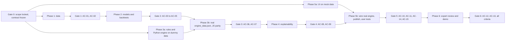

# Polaris CropPilot: Task Breakdown (MVP)

**Source:** `polaris-croppilot-prd.md` v1.0 (19 October 2026)
**Structure:** seven gated phases (PRD §10). Each task is atomic: one owner, one output, one clear "done" check.

## How to read this file

| Column | Meaning |
|---|---|
| **ID** | `<phase>.<nn>`. Dependencies refer to these IDs. |
| **Pri** | PRD priority. **P0** must work in the demo, **P1** should, **P2** is a stretch goal. ★ marks tasks on the *minimum demo path* (PRD §10). |
| **Who** | **H** = human in the browser (the Claude sandbox cannot reach government portals; see G13). **C** = Claude (code execution in the Project). **E** = external expert or testers. |
| **Depends on** | Tasks that must be done first. `—` means none. `Gate N` means the whole phase gate. |
| **Output / done when** | The file or decision produced, and the check that closes the task. |

**Rules for every task**

- Every number produced is labelled `[Data]`, `[Prediction]` or `[Assumption]`.
- Never invent data. If a file is missing, stop and ask for it.
- Every raw file is logged in `raw_sources_log.csv`. Every derived file records its inputs and script.
- Fixed random seeds everywhere (NFR-09).
- P2 tasks start only after every P0 task in the same phase is done (R19).

---

## Dependency overview

**Critical path:** 0 → 1 → 2 → 3b → 4 → 5b → 6. Phase 5a (UI on mock data) and Phase 3a (rules and Python engine on dummy values) run in parallel with Phases 1–2.

---

## Phase 0: set up and lock scope (2–4 h)

**Goal:** confirm the scope can be built with free data before investing time.

### 0A. Platform and project setup

| ID | Task | Pri | Who | Depends on | Output / done when |
|---|---|---|---|---|---|
| 0.01 ★ | Turn on code execution and file creation in Settings > Capabilities | P0 | H | — | Toggle on; artifacts can be created |
| 0.02 | Record which network-egress options appear on the Pro plan (Q-01) | P0 | H | 0.01 | Answer to Q-01 in `decisions_log.md` |
| 0.03 ★ | Confirm usage credits are disabled | P0 | H | — | First row of `zero_cost_checklist.md` ticked (NFR-01) |
| 0.04 | Team decision on Q-04: are free local tools (Python, Claude Code) allowed? | P0 | H | — | Decision in `decisions_log.md` |
| 0.05 ★ | Create the Claude Project "Polaris CropPilot" and upload the PRD | P0 | H | 0.01 | Project exists; PRD file attached |
| 0.06 | Define the file-naming convention (raw, derived, report, config) | P0 | H | 0.05 | `naming_convention.md` |
| 0.07 ★ | Write the Project instructions: labelling rules, naming convention, "never invent data; ask for the file" | P0 | H | 0.06 | Instructions saved in the Project |
| 0.08 | Create `decisions_log.md` and `zero_cost_checklist.md` templates | P0 | C | 0.05 | Both files in the Project |

### 0B. Source availability checks (PRD §5.2)

| ID | Task | Pri | Who | Depends on | Output / done when |
|---|---|---|---|---|---|
| 0.09 ★ | Generate `data_availability_checklist.md`: one row per source × crop × district, with columns for years found, format, login needed, notes | P0 | C | 0.05 | Skeleton with blank cells |
| 0.10 ★ | Check DES portal: login, years and format for the 7 districts × 4 crops (Q-02) | P0 | H | 0.09 | Rows filled |
| 0.11 ★ | Check India Data Portal APY mirror: free download, last year, coverage | P0 | H | 0.09 | Rows filled |
| 0.12 | Check ICRISAT DLD: region coverage, end year, irrigated-area series, status of the 2019-20 update | P0 | H | 0.09 | Rows filled |
| 0.13 ★ | Check CEDA Agri Market Data: 4 commodities × 7 districts from 2001, arrivals included | P0 | H | 0.09 | Rows filled |
| 0.14 | Check Agmarknet report pages for daily data on the 4 commodities | P1 | H | 0.09 | Rows filled |
| 0.15 | Check data.gov.in mandi API (free key, uptime) | P2 | H | 0.09 | Rows filled |
| 0.16 ★ | Check MSP history availability (PIB, CACP), including announcement dates | P0 | H | 0.09 | Rows filled |
| 0.17 ★ | Check CACP Kharif reports and DES cost tables: Karnataka A2+FL for each crop, latest year | P0 | H | 0.09 | Rows filled |
| 0.18 ★ | Check NASA POWER: daily CSV from 1981 at one district HQ point | P0 | H | 0.09 | Rows filled; one sample CSV saved |
| 0.19 | Check IMD gridded rainfall and temperature files: size and subsetting route | P1 | H | 0.09 | Rows filled |
| 0.20 | Check UAS Raichur package of practices: availability and jurisdiction (A-02) | P0 | H | 0.09 | Rows filled |
| 0.21 | Check FAO ECOCROP entries for the 4 crops | P1 | H | 0.09 | Rows filled |
| 0.22 | Check the CPI-AL (Labour Bureau) monthly series | P0 | H | 0.09 | Rows filled |
| 0.23 | Check SoilGrids REST point query | P2 | H | 0.09 | Rows filled |
| 0.24 | Check IMD long-range forecast bulletins | P2 | H | 0.09 | Rows filled |
| 0.25 | Read licence terms for each source, CEDA in particular (Q-03, R18, NFR-13) | P0 | H | 0.10–0.24 | Licence column filled; public demo allowed or blocked per source |

### 0C. Scope decisions and frozen contracts

| ID | Task | Pri | Who | Depends on | Output / done when |
|---|---|---|---|---|---|
| 0.26 ★ | Decide to keep or swap crops (fallbacks: black gram, maize) | P0 | H | 0.10–0.13, 0.16–0.17 | Decision in `decisions_log.md` (A-01) |
| 0.27 ★ | Decide to keep 7 districts or narrow to Kalaburagi, Bidar, Yadgir | P0 | H | 0.10–0.13, 0.18 | Decision in `decisions_log.md` (A-01) |
| 0.28 | Record the 31 May decision date as an assumption, with the plan to check it (A-03) | P0 | H | — | Entry in `decisions_log.md` |
| 0.29 ★ | Freeze the engine data contract from PRD §6.10 as a JSON Schema | P0 | C | 0.26, 0.27 | `engine_data.schema.json` |
| 0.30 ★ | Build mock data that conforms to the schema: all units × crops, dummy draws, every field labelled | P0 | C | 0.29 | `engine_data.mock.json` passes schema validation |
| 0.31 ★ | Write the yield model selection rule (PRD §4.2) before any modelling | P0 | H | — | Section 1 of `selection_rules.md` |
| 0.32 | Write the price ship rule: MAPE skill ≥ 5% and direction accuracy > 50% (PRD §4.3) | P0 | H | — | Section 2 of `selection_rules.md` |
| 0.33 | Write the confidence thresholds (PRD §6.8) | P0 | H | — | Section 3 of `selection_rules.md` |
| 0.34 | Freeze `selection_rules.md` (date and version) | P0 | H | 0.31–0.33 | File marked frozen; changes only with a logged reason |
| 0.35 | Identify a domain reviewer (KVK, UAS, RSK or agri-economics faculty) (G14) | P0 | H | — | Name and contact in `decisions_log.md` |
| 0.36 | Book the Phase 6 expert session | P0 | H | 0.35 | Date confirmed |

### Gate 0

| ID | Task | Pri | Who | Depends on | Output / done when |
|---|---|---|---|---|---|
| 0.G ★ | Gate review: each crop has a viable source for yield, price and cost | P0 | H | 0.25–0.27, 0.29, 0.34 | Pass, or an exception documented in `decisions_log.md` |

---

## Phase 1: data acquisition, cleaning and audit (8–14 h)

**Goal:** a clean, traceable dataset for every model input.

### 1A. Download (browser, every file under 30 MB)

| ID | Task | Pri | Who | Depends on | Output / done when |
|---|---|---|---|---|---|
| 1.01 ★ | Create `raw_sources_log.csv` (file, source URL, download date, coverage, notes) | P0 | C | Gate 0 | Empty log with header |
| 1.02 ★ | Download Karnataka district Kharif yields for the 4 crops (DES, or the India Data Portal mirror) | P0 | H | 1.01 | Raw file(s) logged |
| 1.03 | Download ICRISAT DLD files for the region (yield, area, irrigated area) | P1 | H | 1.01 | Raw files logged |
| 1.04 ★ | Download CEDA monthly prices and arrivals for the 4 commodities in the region | P0 | H | 1.01 | Raw files logged |
| 1.05 ★ | Download the latest CACP Kharif price policy report | P0 | H | 1.01 | PDF logged |
| 1.06 | Download DES Cost of Cultivation tables for Karnataka | P1 | H | 1.01 | Raw files logged |
| 1.07 ★ | Compile district HQ coordinates for the 7 districts | P0 | H | 1.01 | `district_hq_coords.csv` |
| 1.08 ★ | Download NASA POWER daily CSVs from 1985 for each HQ point | P0 | H | 1.07 | 7 CSVs logged |
| 1.09 | Download NASA POWER for 3–5 extra points per district (multi-point averaging) | P1 | H | 1.07 | CSVs logged |
| 1.10 ★ | Compile MSP history for the 4 crops, with announcement dates | P0 | H | 1.01 | Raw file logged |
| 1.11 | Download the CPI-AL monthly series | P0 | H | 1.01 | Raw file logged |
| 1.12 | Subset IMD gridded rainfall to the region locally (Q-04 permitting) | P1 | H | 1.01, 0.04 | Subset file under 30 MB, logged |
| 1.13 | Download recent Agmarknet daily data for spot checks | P1 | H | 1.01 | Raw files logged |
| 1.14 ★ | Upload all raw files to the Project | P0 | H | 1.02–1.13 (those done) | Files visible in the Project |

### 1B. Mapping tables

| ID | Task | Pri | Who | Depends on | Output / done when |
|---|---|---|---|---|---|
| 1.15 ★ | Build the crop-name mapping across DES, CEDA/Agmarknet, CACP and MSP (G12) | P0 | C | 1.14 | `map_crop_names.csv` |
| 1.16 ★ | Build the district → model-unit mapping (5 units, PRD §5.3), including split years | P0 | C | 1.14 | `map_district_units.csv` |
| 1.17 | Verify the split years (Yadgir, Vijayanagara, Koppal) against the yield data | P0 | C | 1.16, 1.02 | Split years confirmed or corrected; noted in the mapping file |
| 1.18 | Map Census 2011 districts (CEDA) to model units | P0 | C | 1.16 | Extra column in `map_district_units.csv` |
| 1.19 | Write tests for both mapping tables (every source name maps exactly once) | P0 | C | 1.15, 1.18 | Tests pass |

### 1C. Yield panel

| ID | Task | Pri | Who | Depends on | Output / done when |
|---|---|---|---|---|---|
| 1.20 ★ | Filter raw yields to the region, Kharif, 4 crops | P0 | C | 1.15, 1.17 | Filtered table; dropped rows logged with reasons |
| 1.21 ★ | Harmonise to model units: sum area and production, then recompute yield | P0 | C | 1.20 | Unit-level table |
| 1.22 ★ | Convert units: tonnes to quintals; cotton bales (170 kg lint) to kg lint per ha | P0 | C | 1.21 | Converted columns |
| 1.23 | Confirm the ginning outturn (0.34 starting value) from CACP tables (A-05) | P0 | C | 1.05 | Value and source written to `config_constants.json` |
| 1.24 | Add sanity-range unit tests for yields per crop (R4) | P0 | C | 1.22 | Tests pass; out-of-range rows listed |
| 1.25 ★ | Write `panel_yield.csv` (unit × season × crop: area, production, yield, source) | P0 | C | 1.22, 1.24 | File plus provenance note |
| 1.26 | Compare DES with ICRISAT for overlapping years | P1 | C | 1.25, 1.03 | Comparison table for the quality report |
| 1.27 | Extend the panel with earlier ICRISAT years if consistent; add irrigated-share feature | P1 | C | 1.26 | Updated `panel_yield.csv` |

### 1D. Weather features

| ID | Task | Pri | Who | Depends on | Output / done when |
|---|---|---|---|---|---|
| 1.28 ★ | Parse NASA POWER CSVs into one daily table (unit, date, rain, Tmax) | P0 | C | 1.08, 1.16 | `weather_daily.csv` |
| 1.29 ★ | Compute monthly rainfall for June–October and the June–September total | P0 | C | 1.28 | Columns in the feature table |
| 1.30 ★ | Compute rainy days (≥ 2.5 mm) and heavy-rain days (≥ 64.5 mm) in September–October | P0 | C | 1.28 | Columns in the feature table |
| 1.31 ★ | Compute the longest dry spell in July–August | P0 | C | 1.28 | Column in the feature table |
| 1.32 ★ | Compute mean Tmax for August–September | P0 | C | 1.28 | Column in the feature table |
| 1.33 ★ | Aggregate HQ points to model units (average across member districts) | P0 | C | 1.29–1.32 | `weather_features.csv` (unit × season) |
| 1.34 | Replace HQ points with multi-point averages | P1 | C | 1.09, 1.33 | Updated `weather_features.csv` |
| 1.35 | Compare NASA POWER rainfall with ICRISAT or IMD for overlapping years (A-07, R11) | P1 | C | 1.33, 1.03 or 1.12 | Comparison table for the quality report |

### 1E. Prices

| ID | Task | Pri | Who | Depends on | Output / done when |
|---|---|---|---|---|---|
| 1.36 ★ | Filter CEDA data to raw commodities (whole tur, not dal; kapas) | P0 | C | 1.04, 1.15 | Filtered table |
| 1.37 | Drop records with zero modal price, or a modal price outside min–max | P0 | C | 1.36 | Dropped rows logged |
| 1.38 | Apply the minimum trading-days-per-month rule `[Assumption]` | P0 | C | 1.37 | Rule value in config; dropped months logged |
| 1.39 | Cap monthly values at the 1st and 99th percentiles per crop and district | P0 | C | 1.38 | Capped values flagged |
| 1.40 ★ | Map to model units and write `prices_monthly.csv` (unit × crop × month: modal, arrivals) | P0 | C | 1.39, 1.18 | File plus provenance note |
| 1.41 | Spot-check recent months against Agmarknet daily data (R9) | P1 | C | 1.40, 1.13 | Check results for the quality report |
| 1.42 | Derive harvest-marketing windows from arrival peaks (G5, A-04) | P0 | C | 1.40 | `harvest_windows.csv`, marked "pending expert check" |

### 1F. Costs and MSP

| ID | Task | Pri | Who | Depends on | Output / done when |
|---|---|---|---|---|---|
| 1.43 ★ | Extract Karnataka A2+FL cost per hectare per crop, with cost year, from CACP/DES PDF tables | P0 | C | 1.05 or 1.06 | Extracted table; page reference per value |
| 1.44 | Extract C2 cost per hectare per crop (for the P2 expert toggle) | P2 | C | 1.43 | Extra column |
| 1.45 | Compute the CPI-AL inflation factor from cost year Y to target season T | P0 | C | 1.11, 1.43 | Factor per crop |
| 1.46 ★ | Write `costs.csv` (crop, A2+FL per acre, source, cost year, inflation factor, band) | P0 | C | 1.43, 1.45 | File; labelled `[Data × Assumption]` |
| 1.47 | Compare inflated costs with any newer CACP estimate (A-13) | P1 | C | 1.46 | Note in the quality report |
| 1.48 ★ | Write `msp.csv` (crop, season, value, announcement date, source) | P0 | C | 1.10, 1.15 | File; announcement dates present for the leakage rule |

### 1G. Audit and gate

| ID | Task | Pri | Who | Depends on | Output / done when |
|---|---|---|---|---|---|
| 1.49 ★ | Build the coverage grid (unit × crop × season) | P0 | C | 1.25 | Grid table |
| 1.50 ★ | Apply the data sufficiency rule (≥ 10 seasons with ≥ 500 ha) | P0 | C | 1.49 | Pass/fail per unit × crop |
| 1.51 | Sensitivity-test the sufficiency thresholds (A-06) | P1 | C | 1.50 | Results table |
| 1.52 ★ | Compile `data_quality_report.md`: coverage grid, missing values, outliers, unit checks, cross-source comparisons | P0 | C | 1.24, 1.26, 1.35, 1.41, 1.47, 1.50 (those done) | Report in the Project |
| 1.53 ★ | Update `data_gap_register.md`: status of G1–G14 and every source's coverage, download date and known issues | P0 | C | 1.52 | Register current (AC-02) |
| 1.G ★ | Gate review: AC-01 (≥ 3 crops pass in ≥ 3 units; ≥ 10 price seasons per crop; dated cost per crop) and AC-02 | P0 | H | 1.53, 1.40, 1.46 | Pass; or swap crops / narrow districts and re-run 1.20 onward |

---

## Phase 2: baselines and ML models (6–10 h)

**Goal:** honest evidence of what the models can and cannot do.

### 2A. Backtest infrastructure

| ID | Task | Pri | Who | Depends on | Output / done when |
|---|---|---|---|---|---|
| 2.01 ★ | Build the as-of information set per decision date (31 May): yields published by then, MSP only if announced before 31 May, prices to May (PRD §4.5) | P0 | C | Gate 1 | `asof.py` with tests |
| 2.02 ★ | Write the leakage checklist for code review (R7) | P0 | C | 2.01 | `leakage_checklist.md` |
| 2.03 ★ | Build the rolling-origin harness: test seasons 2012 to latest; train on earlier seasons only | P0 | C | 2.01 | `backtest.py` |
| 2.04 ★ | Write the metrics module: MAE, MAPE, skill vs baseline, 10–90 interval coverage, direction accuracy, n | P0 | C | — | `metrics.py` with unit tests |
| 2.05 ★ | Build the yield feature matrix (panel × weather features, district indicator, year trend) | P0 | C | 1.25, 1.33 | `features_yield.csv` |

### 2B. Baselines

| ID | Task | Pri | Who | Depends on | Output / done when |
|---|---|---|---|---|---|
| 2.06 ★ | Yield baseline B1: mean of the unit's previous five seasons | P0 | C | 2.03 | Backtest rows per crop |
| 2.07 | Yield baseline B2: unit linear trend | P0 | C | 2.03 | Backtest rows per crop |
| 2.08 ★ | Build the price target: harvest-window mean modal price, and log(window price ÷ May price) | P0 | C | 1.40, 1.42 | `features_price.csv` (target columns) |
| 2.09 ★ | Price baseline P1: persistence (harvest price = May price) | P0 | C | 2.03, 2.08 | Backtest rows per crop |
| 2.10 | Price baseline P2: seasonal naive (last year's harvest-window price) | P0 | C | 2.03, 2.08 | Backtest rows per crop |

### 2C. Yield models

| ID | Task | Pri | Who | Depends on | Output / done when |
|---|---|---|---|---|---|
| 2.11 ★ | M1: ridge per crop, standardised features, alpha by inner time-series CV | P0 | C | 2.04, 2.05 | Hindcast backtest rows |
| 2.12 | M2: pooled HistGradientBoostingRegressor with crop as a feature, inner CV | P1 | C | 2.04, 2.05 | Hindcast backtest rows |
| 2.13 | M3: random forest (optional) | P2 | C | 2.04, 2.05 | Hindcast backtest rows |
| 2.14 ★ | Compute relative residual distributions per crop from backtests | P0 | C | 2.11 (and 2.12) | Residuals saved |
| 2.15 ★ | Weather-season resampling per test season: run the model under every historical weather season, apply residual draws | P0 | C | 2.14 | Draws per test season |
| 2.16 ★ | Compute decision-time skill (median of draws) and interval coverage | P0 | C | 2.15 | Metrics per crop |
| 2.17 | Sensitivity test: weather seasons from 2001 only (A-08, R12) | P1 | C | 2.15 | Comparison table |

### 2D. Price model

| ID | Task | Pri | Who | Depends on | Output / done when |
|---|---|---|---|---|---|
| 2.18 | Build price features: May price, 12-month mean, last window price, MSP (as-of rule), last window arrivals vs 5-year mean | P1 | C | 2.08, 1.48, 2.01 | `features_price.csv` complete |
| 2.19 | Pooled ridge price model with inner CV | P1 | C | 2.18 | Backtest rows |
| 2.20 | Gradient-boosted price model | P2 | C | 2.18 | Backtest rows |
| 2.21 ★ | Compute price log-errors per season for the chosen model or baseline (for paired-season sampling) | P0 | C | 2.09–2.10 (and 2.19) | Error table keyed by season |
| 2.22 | Compute metric uncertainty (bootstrap CIs) and state the effective sample size | P1 | C | 2.21 | Table for the model card |

### 2E. Selection, contingency, exports

| ID | Task | Pri | Who | Depends on | Output / done when |
|---|---|---|---|---|---|
| 2.23 ★ | Apply the yield selection rule from `selection_rules.md` per crop | P0 | C | 2.06, 2.07, 2.11, 2.16 | Chosen model per crop, with reason |
| 2.24 | Apply the price ship rule per crop | P0 | C | 2.09, 2.10, 2.19 | Chosen model per crop, with reason |
| 2.25 | **Contingency** (only if ML wins for < 2 crops): pooled model → IMD rainfall → fewer crop-specific features → wider district pool | P0 | C | 2.23, 2.24 | Each attempt reported; final choice logged |
| 2.26 | Check confidence thresholds against the backtest distribution (A-09) | P1 | C | 2.16 | Note added to `selection_rules.md` (thresholds stay frozen unless a reason is logged) |
| 2.27 ★ | Extract yield drivers: ridge contributions or permutation importance | P0 | C | 2.23 | `drivers.json` |
| 2.28 ★ | Write `model_card_yield.md` (all items in PRD §4.6, every crop, including losers) | P0 | C | 2.23, 2.27 | Model card (AC-03) |
| 2.29 | Write `model_card_price.md` | P0 | C | 2.24, 2.22 | Model card (AC-04) |
| 2.30 ★ | Export Kharif 2027 yield predictions per unit × crop × weather season (1991 onward) with residuals | P0 | C | 2.23 | `export_yield_draws.json` |
| 2.31 ★ | Export Kharif 2027 price forecasts with log-errors and error seasons | P0 | C | 2.21, 2.24 | `export_price.json` |
| 2.32 | Store scripts, data snapshots and seeds in the Project; rerun and confirm identical metrics (NFR-09) | P0 | C | 2.28, 2.29 | Rerun log matches |
| 2.G ★ | Gate review: AC-03, AC-04, AC-05 (or contingency run and reported) | P0 | H | 2.25, 2.28–2.32 | Pass or documented exception |

---

## Phase 3: recommendation and profitability engine (6–8 h)

**Goal:** a tested engine that turns predictions into ranked, explained options.
Tasks 3.01–3.30 use dummy values and can start after Gate 0 (Phase 3a). Tasks 3.31 onward need Gate 2 (Phase 3b).

### 3A. Rules config (all labelled `[Assumption — unreviewed]`)

| ID | Task | Pri | Who | Depends on | Output / done when |
|---|---|---|---|---|---|
| 3.01 ★ | Exclusion rules: sufficiency failure, sowing windows per crop | P0 | C | Gate 0 | `rules.json` › `exclusions` |
| 3.02 ★ | Suitability matrix (PRD §6.2) | P0 | C | Gate 0 | `rules.json` › `suitability` |
| 3.03 ★ | Tier multipliers (1.00 / 0.90 / 0.75 / excluded) | P0 | C | Gate 0 | `rules.json` › `multipliers` |
| 3.04 | Flags: same crop again, cotton after cotton, Soil Health Card ranges (expert-set, empty until Phase 6), field occupancy | P0 | C | Gate 0 | `rules.json` › `flags` |
| 3.05 ★ | λ per risk preference, tie-break (5%) and close-call (10 pp) thresholds | P0 | C | Gate 0 | `rules.json` › `ranking` |
| 3.06 | Calibration clip (0.6–1.4), protective-irrigation α (0.5), cost band (−10% / +15%), override band (±10%) | P0 | C | Gate 0 | `rules.json` › `adjustments` |

### 3B. Python reference engine (PRD §6)

| ID | Task | Pri | Who | Depends on | Output / done when |
|---|---|---|---|---|---|
| 3.07 ★ | Seeded PRNG shared by Python and JS (for example mulberry32), so draws match exactly | P0 | C | — | `prng.py` with known-sequence test |
| 3.08 ★ | Eligibility and exclusion step, with reasons | P0 | C | 3.01 | Function + tests |
| 3.09 ★ | Suitability tier and multiplier lookup, including "don't know" | P0 | C | 3.02, 3.03 | Function + tests |
| 3.10 | Flag generation | P0 | C | 3.04 | Function + tests |
| 3.11 ★ | Yield draws: `Y_i = ŷ(T, w_i) × (1 + e_i) × m`, ~2,000 draws | P0 | C | 3.07, 3.09 | Function + tests |
| 3.12 | Farmer calibration ratio r, clipped, replacing m | P1 | C | 3.11, 3.06 | Function + tests |
| 3.13 | Protective irrigation: move driest-third draws halfway to the median | P0 | C | 3.11, 3.06 | Function + tests |
| 3.14 ★ | Unit conversion: kg/ha → quintals/acre; cotton lint → kapas | P0 | C | — (uses 0.34 ginning outturn until 1.23 confirms it) | Function + tests |
| 3.15 ★ | Price draws `P_i = P̂ × exp(r_i)`, paired with weather season where possible | P0 | C | 3.07 | Function + tests |
| 3.16 ★ | Base cost per acre with CPI-AL factor | P0 | C | — | Function + tests |
| 3.17 ★ | Cost draws (−10% / +15%) and user override (±10%) | P0 | C | 3.16, 3.06 | Function + tests |
| 3.18 ★ | Net return per acre and whole field (acres + guntas ÷ 40) | P0 | C | 3.11, 3.15, 3.17 | Function + tests |
| 3.19 ★ | Low / base / high (P10 / P50 / P90) and chance of loss | P0 | C | 3.18 | Function + tests |
| 3.20 | Win rate, with draws aligned by weather season | P1 | C | 3.18 | Function + tests |
| 3.21 ★ | Break-even price and break-even yield | P0 | C | 3.18 | Function + tests |
| 3.22 ★ | Score `(1 − λ) × base + λ × low`, sort, tie-break | P0 | C | 3.19, 3.05 | Function + tests |
| 3.23 | Close-call badge | P1 | C | 3.20, 3.22 | Function + tests |
| 3.24 | Assured-irrigation notice and forced low confidence | P0 | C | 3.08 | Function + tests |

### 3C. Engine tests

| ID | Task | Pri | Who | Depends on | Output / done when |
|---|---|---|---|---|---|
| 3.25 ★ | Unit tests for the PRD §6.9 dummy cases, including rank flips across risk preferences | P0 | C | 3.21, 3.22 | Tests pass (AC-07) |
| 3.26 | Test: negative returns | P0 | C | 3.19 | Test passes |
| 3.27 | Test: missing optional inputs | P0 | C | 3.08–3.24 | Test passes |
| 3.28 | Test: unknown soil and drainage | P0 | C | 3.09 | Test passes |
| 3.29 | Test: assured irrigation; late sowing excludes soybean (maize window to confirm with the expert) | P0 | C | 3.08, 3.24 | Tests pass |
| 3.30 ★ | Define 10 test farms covering districts, soils, water, risk preferences and overrides | P0 | C | — | `test_farms.json` |

### 3D. Real data, JS port, parity

| ID | Task | Pri | Who | Depends on | Output / done when |
|---|---|---|---|---|---|
| 3.31 ★ | Assemble `engine_data.json` from 2.30, 2.31, `costs.csv`, `msp.csv`, `rules.json`, backtest metrics | P0 | C | Gate 2, 3.01–3.06 | File validates against the schema |
| 3.32 ★ | Check `engine_data.json` is under 1 MB; thin or quantise arrays if not (NFR-04) | P0 | C | 3.31 | Size logged |
| 3.33 ★ | Port the engine to a JavaScript module (same PRNG and seed) | P0 | C | 3.07–3.24 | `engine.js` |
| 3.34 ★ | JS unit tests for the §6.9 dummy cases | P0 | C | 3.33 | Tests pass |
| 3.35 ★ | Parity test: JS vs Python on the 10 test farms, ±1% on percentiles, exact ranks | P0 | C | 3.30, 3.31, 3.33 | `parity_test_log.md` (AC-06) |
| 3.36 | Performance check: 4 crops × 2,000 draws in under 2 s (NFR-03) | P0 | C | 3.33 | Timing logged |
| 3.37 | Decision backtest (PRD §9.3): standard farm, realised returns, regret vs "always tur" and "last season's best" | P1 | C | 3.31 | `decision_backtest.md` |
| 3.G ★ | Gate review: AC-06, AC-07 | P0 | H | 3.25, 3.35 | Pass |

---

## Phase 4: explainability (3–5 h)

**Goal:** every number explained, labelled and phrased honestly.

| ID | Task | Pri | Who | Depends on | Output / done when |
|---|---|---|---|---|---|
| 4.01 ★ | Write the banned-word list ("will", "guaranteed", "sure", "assured" and variants) with allowed exceptions (for example "assured irrigation") | P0 | C | — | `banned_words.json` |
| 4.02 ★ | Write the banned-word scanner for templates and UI strings | P0 | C | 4.01 | Script + tests |
| 4.03 ★ | Write reason templates with slots (lowest cost, best low scenario, highest win rate, and so on) | P0 | C | — | `templates.json` › `reasons` |
| 4.04 ★ | Reason selection: up to three per crop, from comparisons | P0 | C | 4.03, Gate 3 | Function + tests (Python and JS) |
| 4.05 | Driver sentences from `drivers.json` | P0 | C | 2.27, 4.03 | Templates + function |
| 4.06 | Analog seasons: name the weather years behind the low and high draws | P0 | C | Gate 3 | Function + tests |
| 4.07 | Weather sensitivity: change in median yield in the driest third of seasons | P0 | C | Gate 3 | Value per unit × crop in `engine_data.json` |
| 4.08 | Price volatility: CV of harvest-window prices over the last 10 seasons `[Data]` | P0 | C | 1.40, 1.42 | Value per unit × crop in `engine_data.json` |
| 4.09 ★ | Confidence badge logic from the frozen thresholds | P0 | C | 0.34, 2.28 | Function + tests (Python and JS) |
| 4.10 | Fixed text: meaning of low / base / high; "outside the range about one season in five" | P0 | C | 4.03 | `templates.json` › `meanings` |
| 4.11 | Fixed text: "what this tool cannot see" | P0 | C | 4.03 | `templates.json` › `limits` |
| 4.12 | "Assumptions used" list per crop card, generated from labels | P0 | C | 3.31 | Function |
| 4.13 | Pest-risk note placeholders, marked "awaiting expert" (G9) | P1 | C | — | `templates.json` › `pest_notes` |
| 4.14 ★ | Label audit script: every displayed number has a label and a source or method (NFR-06) | P0 | C | 4.04–4.12 | Script + tests |
| 4.15 ★ | Generate explanations for the 10 test farms | P0 | C | 4.04–4.12 | `explanations_test_farms.md` |
| 4.16 | Plain-language review of the generated explanations; fix templates | P0 | H | 4.15 | Review notes; templates updated |
| 4.17 ★ | Run the label audit and banned-word scan on the generated output | P0 | C | 4.02, 4.14, 4.16 | Zero failures (AC-08, AC-09 for engine output) |
| 4.G ★ | Gate review: AC-08, AC-09 | P0 | H | 4.17 | Pass |
| 4.18 | Optional AI rephrasing or Kannada output: receives computed values, must return them unchanged; templates as fallback (FR-22) | P2 | C | Gate 5 | Feature behind a toggle; number-preservation test passes |

---

## Phase 5: dashboard (6–10 h)

**Goal:** a published, mobile-first artifact that runs the whole journey.
Phase 5a (5.01–5.24) uses `engine_data.mock.json` and can start right after Gate 0.

### 5A. Foundation (mock data)

| ID | Task | Pri | Who | Depends on | Output / done when |
|---|---|---|---|---|---|
| 5.01 ★ | Scaffold a single-file HTML/React artifact with embedded mock JSON and no network requests | P0 | C | 0.30 | Artifact renders |
| 5.02 ★ | Mobile-first layout at 360 px, large touch targets, portrait (NFR-05) | P0 | C | 5.01 | Checked at 360 px |
| 5.03 ★ | Label chip component: Data / Prediction / Assumption / farmer-reported | P0 | C | 5.01 | Component |
| 5.04 ★ | Indian number formatting (₹1,25,000) with tests (NFR-11) | P0 | C | 5.01 | Utility + tests |
| 5.05 ★ | Acres + guntas input and conversion | P0 | C | 5.01 | Component + tests |
| 5.06 | App state and navigation across S1–S7 | P0 | C | 5.01 | Navigation works |
| 5.07 | Temporary JS stub of the engine reading mock data | P0 | C | 5.01 | Ranked mock output |

### 5B. Screens

| ID | Task | Pri | Who | Depends on | Output / done when |
|---|---|---|---|---|---|
| 5.08 | S1 Welcome: disclaimer, season, region, data as-of dates | P0 | C | 5.06 | Screen done |
| 5.09 ★ | S2 Farm profile: all FR-01 fields, validation, "don't know" options (FR-03) | P0 | C | 5.05, 5.06 | Screen done |
| 5.10 | S2 optional inputs: Soil Health Card, own yield, own cost, late sowing (FR-02) | P1 | C | 5.09 | Fields done |
| 5.11 ★ | S3 Ranked crop cards: low / base / high per acre and per field, chance of loss, suitability, confidence | P0 | C | 5.03, 5.04, 5.07 | Screen done |
| 5.12 | S3 side-by-side comparison table | P0 | C | 5.11 | Table done |
| 5.13 | S3 excluded crops shown at the bottom with reasons | P0 | C | 5.11 | Section done |
| 5.14 | Close-call badge on cards | P1 | C | 5.11 | Badge shown when flagged |
| 5.15 ★ | S4 Crop detail: reasons, drivers, assumptions, risks, analog seasons, confidence, sources with dates | P0 | C | 5.11 | Screen done |
| 5.16 | MSP reference line on charts (not a floor) | P0 | C | 5.15 | Line drawn and labelled |
| 5.17 | S5 What-if: price, cost, risk preference; live re-rank; show when the ranking flips | P1 | C | 5.11 | Screen done |
| 5.18 ★ | S6 Select any crop, optional reason; summary says the decision is theirs and suggests an RSK/KVK visit | P0 | C | 5.11 | Screen done |
| 5.19 | S6 Save / print / share the summary with all labels and disclaimers | P0 | C | 5.18 | Print and share work |
| 5.20 | S7 About the model and data: model card summary, backtests vs baselines, gap register, limitations | P0 | C | 5.06 | Screen done (content filled at 5.27) |
| 5.21 | S8 Expert mode: view rules, multipliers, weights, metrics; session edits; review note | P1 | C | 5.11 | Screen done |
| 5.22 | Kannada interface labels (FR-20) | P2 | C | 5.08–5.20 | Toggle works; native speaker check queued (R17) |
| 5.23 | Save and reload a farm profile on the device (FR-21) | P2 | C | 5.09 | Works; app still works if storage is unavailable |
| 5.24 | Disclaimers and RSK/KVK prompts on every relevant screen | P0 | C | 5.08–5.20 | Checked against the screen list |

### 5C. Wire the real engine (needs Gate 4)

| ID | Task | Pri | Who | Depends on | Output / done when |
|---|---|---|---|---|---|
| 5.25 ★ | Replace the mock JSON and stub with `engine_data.json` and `engine.js` | P0 | C | Gate 4, 5.11 | Real results render |
| 5.26 ★ | Embed templates, reasons, drivers and confidence logic | P0 | C | 5.25, 4.G | Cards and detail fully populated |
| 5.27 | Fill S7 from the model cards and gap register | P0 | C | 5.20, 2.28, 2.29, 1.53 | Content complete |
| 5.28 ★ | Run the label audit and banned-word scan on the rendered UI strings | P0 | C | 5.26, 4.02, 4.14 | Zero failures (AC-08, AC-09) |
| 5.29 | Render-time check on a mid-range phone (< 2 s) | P0 | H | 5.26 | Timing logged (NFR-03) |
| 5.30 ★ | Test on a phone and a desktop; fix layout issues | P0 | H | 5.26 | Issues closed |
| 5.31 ★ | Publish the artifact | P0 | H | 5.28, 5.30 | Public link |
| 5.32 ★ | Open the link in a logged-out browser and run the core flow | P0 | H | 5.31 | Pass (AC-14) |
| 5.33 ★ | Manual test: any eligible crop can be selected; summary states the decision is theirs | P0 | H | 5.31 | Pass (AC-15) |

### 5D. User testing

| ID | Task | Pri | Who | Depends on | Output / done when |
|---|---|---|---|---|---|
| 5.34 | Recruit 3–5 testers (farmers or extension staff; stand-ins otherwise) | P0 | H | Gate 0 | Names and slots booked |
| 5.35 | Write the test script: timed journey task plus comprehension questions ("what does low mean?", "why is the top crop first?") | P0 | H | — | `usability_test_script.md` |
| 5.36 ★ | Run the usability test: profile → results → selection in ≤ 5 min | P0 | E | 5.31, 5.34, 5.35 | Results (AC-10) |
| 5.37 ★ | Run the comprehension test | P0 | E | 5.31, 5.34, 5.35 | Results (AC-11) |
| 5.38 | Review λ, tie-break and close-call thresholds against test feedback (A-15, A-16) | P1 | H | 5.36, 5.37 | Decision logged; `rules.json` updated if needed |
| 5.39 | Fix issues found in testing and republish | P0 | C | 5.36, 5.37 | Fixes published |
| 5.G ★ | Gate review: AC-10, AC-11, AC-14, AC-15 | P0 | H | 5.32, 5.33, 5.39 | Pass |

---

## Phase 6: expert validation and demo hardening (3–6 h)

**Goal:** expert-checked rules and a demo that shows the evaluation honestly.

| ID | Task | Pri | Who | Depends on | Output / done when |
|---|---|---|---|---|---|
| 6.01 ★ | Prepare the expert pack: rules, suitability matrix, multipliers, sowing windows, costs, harvest windows, α, clip range, MSP-as-reference, 5–10 sample outputs | P0 | C | Gate 5 | `expert_pack.md` |
| 6.02 ★ | Hold the expert session | P0 | E | 6.01, 0.36 | Session notes |
| 6.03 | Collect Soil Health Card thresholds and pest-risk notes from the expert | P1 | E | 6.02 | Values for `rules.json` and `templates.json` |
| 6.04 ★ | Write and sign the review note: every issue fixed or documented | P0 | E | 6.02 | `expert_review_note.md` (AC-12) |
| 6.05 ★ | Update `rules.json`: apply corrections; change labels to "expert-reviewed (name, date)" | P0 | C | 6.04 | Rules updated (A-10, A-11, A-12, A-14) |
| 6.06 | Update `harvest_windows.csv` and re-run price backtests if windows changed | P0 | C | 6.04 | Files updated; backtests re-run if needed |
| 6.07 ★ | Rebuild `engine_data.json`, re-run Python tests and JS parity | P0 | C | 6.05, 6.06 | Tests and parity pass |
| 6.08 | Finish S7 and the limitations list | P0 | C | 6.07 | Content final |
| 6.09 ★ | Republish the artifact; re-run the logged-out test | P0 | H | 6.07, 6.08 | Link works |
| 6.10 ★ | Complete the zero-cost checklist: no paid services, usage credits disabled | P0 | H | 6.09 | Checklist signed (AC-13) |
| 6.11 | Write the yearly refresh checklist (costs, MSP, prices, yields, rules) (NFR-10) | P1 | C | 6.07 | `refresh_checklist.md` |
| 6.12 ★ | Sweep all acceptance criteria AC-01 to AC-15 and record status | P0 | H | 6.09, 6.10 | `acceptance_report.md` |
| 6.13 ★ | Write the demo script: one farm end to end; ranking change with risk preference; a close call; backtest vs baselines, including where the baseline won; an expert adjustment | P0 | H | 6.09 | `demo_script.md` |
| 6.14 | Rehearse the demo once, timed | P0 | H | 6.13 | Rehearsal done |
| 6.G ★ | Final gate: AC-12, AC-13 and all criteria | P0 | H | 6.12, 6.14 | Ready to demo |

---

## Minimum demo path (if time runs short)

Do only the ★ tasks, plus these simplifications from PRD §10:

1. Phase 0 in about an hour.
2. Phase 1 with yields, NASA POWER, CEDA prices and CACP costs only.
3. Phase 2 with ridge vs B1 for yield and persistence (P1) for price.
4. Phase 3 core engine, no decision backtest (skip 3.37).
5. Phase 5 with screens S2, S3, S4 and S6.
6. Phase 6 as a quick peer review.

The ML yield model and its honest backtest stay in, even on this path.

## Post-hackathon backlog (not scheduled)

In-season updates after June rainfall · seasonal-forecast weighting of weather seasons · Kharif + Rabi profit sequences · more crops (black gram, maize) · taluk-level data · Kannada voice · FPO pilot · tracking real outcomes against predicted ranges.
